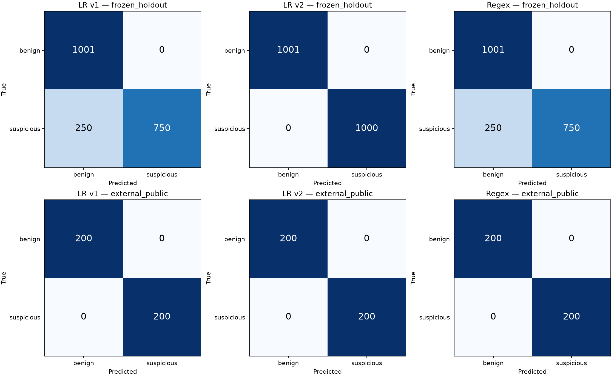
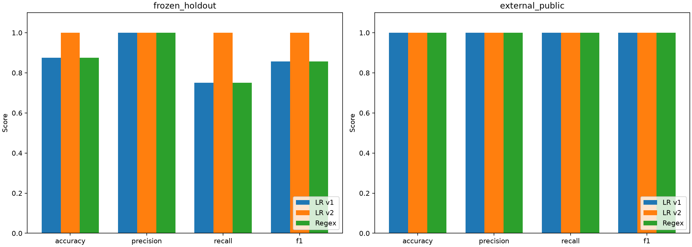
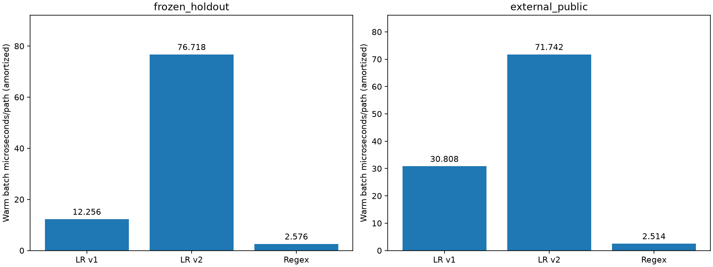

# Cải tiến đặc trưng Logistic Regression — thực nghiệm Chương 4

Thực hiện **16/11/2026, khoảng 22:44–22:52, Asia/Saigon**.
Mã thực nghiệm: `20261116T154448Z_7a27a7`.

## 1. Nguyên nhân 250 false negatives

Tất cả 250 FN của LR v1 ở lần chia seed 2026 thuộc family `1-16`, dạng
`%252e%252e%252f{f}`. Ví dụ `%252e%252e%252fconfig_2968.env`:

- Các đặc trưng cũ `dotdot`, `depth_slash`, `backslashes`, `encoded_dot`,
  `encoded_slash`, `encoded_backslash` đều bằng **0**.
- V1 chỉ URL-decode một lần để đếm traversal; chuỗi vẫn là
  `%2e%2e%2f...`, chưa có `../`. Các cờ encoded_* chỉ tìm escape một lớp
  trong chuỗi gốc, nên không thấy `%252e`/`%252f`.
- Regex cũ cũng chỉ xét marker một lớp, nên bỏ sót cùng family.
- Xác suất nghi vấn của v1 trên 250 FN: min **0,009425**, median
  **0,027928**, max **0,088420**, đều dưới ngưỡng 0,5.

Đây là thiếu tín hiệu biểu diễn cú pháp, không phải bằng chứng mô hình
đã cấp quyền đọc file. Lớp security độc lập vẫn chặn các payload này.
[Bằng chứng phân tích đặc trưng và xác suất](evaluations/20261116T154448Z_7a27a7/fn_analysis.json).

## 2. Bộ đặc trưng v2

Giữ nguyên hàm `extract_features` và 18 đặc trưng v1 để không làm mất
tương thích model triển khai. Thêm `extract_features_v2`, gồm **30 đặc trưng**:
18 cũ và 12 tín hiệu tổng hợp trên ba view raw / decode một lần / decode hai lần.

Tín hiệu mới: số/tỷ lệ thành phần `..`, rooted path, Windows drive, UNC,
số separator, separator trộn, mức thoát ra ngoài theo chuỗi thành phần,
thành phần `.`, NUL, escape cấu trúc và số lượt decode có thay đổi chuỗi.
Lấy giá trị lớn nhất qua các view để dùng chung tín hiệu đã học từ raw
hoặc single encoding với biểu diễn double encoding.

Giải mã **tối đa đúng hai lần**, chỉ cho phân tích AI; không có vòng lặp
đến khi chuỗi ổn định, không dùng `unquote_plus`, không đưa view đã giải
mã vào luồng mở file. View mới giới hạn 4.096 ký tự. `security.py` và
quy tắc giải mã của `/download` không thay đổi.

## 3. Giữ test cố định và chọn C bằng validation

Reference: `20261116T153450Z_e5b13b`. Sao chép nguyên model v1 đã lưu,
không huấn luyện lại baseline. Kiểm tra hash dataset, split, model và
kết quả reference; dùng đúng **2.001 dòng test cũ** cho cả ba phương pháp.

Từ **7.999 dòng original train**, tách theo family bằng seed **1701**:

- Fit: **6.583** mẫu, 23 family.
- Validation: **1.416** mẫu, 5 family.
- Test cũ: 2.001 mẫu, 7 family; không đưa vào lựa chọn C.

Đặc trưng v2 cố định trước khi chọn tham số. Thử C = **0,1 / 1 / 10**,
giữ ngưỡng 0,5, các tham số còn lại như baseline. Ba cấu hình đều đạt
validation F1 = 1, nên chọn **C=0,1** theo quy tắc định trước: F1 cao nhất,
hòa chọn C nhỏ nhất. Sau đó refit v2 trên **toàn bộ original train 7.999 mẫu**.
Không fit scaler trên validation trong bước lựa chọn; khi refit, scaler
fit trên original train. Không dùng test hay tập ngoài để fit/tuning.

Model được đóng băng lúc **15:44:49 UTC**, trước khi thu thập corpus ngoài
lúc **15:47:31 UTC**. CLI `prepare` chỉ lựa chọn/refit, còn `evaluate`
không có thao tác fit. Protocol, selection và model có hash để kiểm tra.

**Giới hạn về tính độc lập:** test cũ đã được xem và FN đã được công bố
trước lần cải tiến này. Yêu cầu phân tích lỗi cũng dùng thông tin đã biết
đó. Vì vậy đây là **benchmark tái sử dụng**, không thể trung thực gọi là
test hoàn toàn chưa nhìn thấy khi nghiên cứu đặc trưng. Lần thử này không
chọn cấu hình theo điểm test, không đổi test hoặc lặp sửa đặc trưng sau
khi thấy điểm. Cần test tương lai do bên khác khóa để đánh giá độc lập hơn.

[Protocol](evaluations/20261116T154448Z_7a27a7/protocol.json),
[validation và selection](evaluations/20261116T154448Z_7a27a7/selection.json),
[membership fit/validation](evaluations/20261116T154448Z_7a27a7/development_split.csv).

## 4. Tập ngoài từ nguồn công khai

Corpus **400 mẫu**, gồm 200 suspicious và 200 benign controls:

- Payload từ [SecLists LFI-Jhaddix](https://github.com/danielmiessler/SecLists/blob/4d5e414c9631f3c12ee1ac86ff7234d848391fd3/Fuzzing/LFI/LFI-Jhaddix.txt),
  commit `4d5e414c9631f3c12ee1ac86ff7234d848391fd3`, MIT.
- Benign là tên file tương đối có thật trong
  [Flask 3.1.2](https://github.com/pallets/flask/tree/2c1b30d0503cfb064f1cb252e6614a06915a362a),
  commit `2c1b30d0503cfb064f1cb252e6614a06915a362a`, BSD-3-Clause.
- Nền tảng kỹ thuật: [OWASP Double Encoding](https://community.owasp.org/Double_Encoding).

Snapshot nguồn và giấy phép được lưu, cùng URL, commit, dòng nguồn và
lý do nhãn cho từng mẫu. Chuẩn hóa Unicode NFC và bỏ whitespace quanh
dòng payload; giữ nguyên case, `%` encoding và separator trong input
model. Không gửi payload tấn công tới host công khai.

Nhãn độc lập với dự đoán: suspicious khi có parent component, absolute/UNC
hoặc drive trong raw/tối đa hai lớp decode; benign khi tên file repo
tương đối không có các dấu hiệu đó. Đây là **nhãn lexical theo chính sách**,
không phải nhãn khai thác thành công do bên thứ ba cung cấp. LFI wrapper
hoặc tên nhạy cảm tương đối không có bằng chứng traversal nằm ngoài phạm
vi được loại, không tự coi là malicious/benign.

Có 719 positive và 234 negative đủ điều kiện; loại 211 dòng ngoài phạm
vi. Chọn 200 mỗi lớp bằng thứ tự SHA-256(path), không theo model prediction.
Không trùng exact hoặc canonical hai-decode/slash/casefold với toàn bộ
10.000 mẫu gốc. Nội bộ corpus không trùng exact; còn **2 dòng dư theo
canonical**, được giữ và công khai là các biến thể tương quan.

**Độ khó thực tế của corpus:** 141 positive là absolute/UNC raw,
51 có parent component raw, 6 Windows drive raw, 2 parent sau decode một
lần. **Không có mẫu cần hai lớp decode trong 200 positive được chọn.**
Do đó corpus này không kiểm chứng độc lập khả năng xử lý double encoding.
Không thay bộ chọn mẫu sau khi nhìn thấy kết quả để làm điểm so sánh tốt hơn.
Nguồn và nhãn có tương quan; tên file repo không đại diện benign traffic.
Không gọi corpus này là benchmark thực địa hoặc hoàn toàn blind đối với
người nghiên cứu vốn có thể đã biết payload công khai.

[Dataset và quy tắc đầy đủ](../data/external/20261116T154731Z_66a7c6/README.md),
[CSV provenance](../data/external/20261116T154731Z_66a7c6/external_cases.csv),
[manifest nguồn](../data/external/20261116T154731Z_66a7c6/external_manifest.json),
[phân tích coverage](evaluations/20261116T154448Z_7a27a7/external_analysis.json).

## 5. Kết quả thực tế

### Benchmark cũ cố định — 2.001 mẫu

| Method | Accuracy | Precision | Recall | F1 | TN | FP | FN | TP |
|---|---:|---:|---:|---:|---:|---:|---:|---:|
| LR v1 | 0,875062 | 1,000000 | 0,750000 | 0,857143 | 1001 | 0 | 250 | 750 |
| LR v2 | 1,000000 | 1,000000 | 1,000000 | 1,000000 | 1001 | 0 | 0 | 1000 |
| Regex cũ | 0,875062 | 1,000000 | 0,750000 | 0,857143 | 1001 | 0 | 250 | 750 |

V2 nhận đúng toàn bộ 250 FN cũ; xác suất của v2 trên nhóm đó có median
**0,995548**, min **0,991315**, max **0,998124**. Không có FP mới trên
holdout này. Kết quả cho thấy cải thiện trên benchmark đã biết; không đủ
kết luận đạt 100% cho tấn công thực tế.

### Corpus ngoài — 400 mẫu

| Method | Accuracy | Precision | Recall | F1 | TN | FP | FN | TP |
|---|---:|---:|---:|---:|---:|---:|---:|---:|
| LR v1 | 1,000000 | 1,000000 | 1,000000 | 1,000000 | 200 | 0 | 0 | 200 |
| LR v2 | 1,000000 | 1,000000 | 1,000000 | 1,000000 | 200 | 0 | 0 | 200 |
| Regex cũ | 1,000000 | 1,000000 | 1,000000 | 1,000000 | 200 | 0 | 0 | 200 |

Corpus ngoài chưa chứng minh v2 hơn hai baseline: **cả ba bằng nhau**.
Đây là giới hạn về phạm vi và độ khó của corpus, không phải lý do để sửa
nhãn, lựa lại payload hay tuning theo external test.




### Thời gian dự đoán

15 lượt warm batch, có warmup. Thời gian đầu cuối gồm trích đặc trưng,
predict_proba và ngưỡng với LR; regex gồm gọi rule. Không bao gồm HTTP,
SQLite hay I/O. µs/path là median batch chia số mẫu, không phải latency
từng request. Đo trên cùng máy; hệ điều hành và tải nền có thể gây nhiễu.

| Dataset | Method | Median batch ms | P95 batch ms | Amortized µs/path |
|---|---|---:|---:|---:|
| Holdout | LR v1 | 24,525100 | 26,659500 | 12,256422 |
| Holdout | LR v2 | 153,513400 | 164,017080 | 76,718341 |
| Holdout | Regex | 5,155200 | 6,714770 | 2,576312 |
| External | LR v1 | 12,323000 | 14,075090 | 30,807500 |
| External | LR v2 | 28,696900 | 31,886580 | 71,742250 |
| External | Regex | 1,005800 | 1,445460 | 2,514500 |

V2 tốn thời gian trích đặc trưng hơn v1 và regex trong lần đo này.
Không có bằng chứng cải thiện tốc độ. Số đo inference-only và tất cả
lượt batch thô được lưu trong JSON.



## 6. Kiểm thử, dashboard và model triển khai

- **Pytest: 47 passed, 3 skipped, 15 subtests passed**, không FAIL,
  nâng cảnh báo lệch phiên bản sklearn thành lỗi.
- **TCP dashboard: 14 PASS, 0 FAIL**, kiểm tra đủ cả ba phương pháp trên
  hai tập, đúng byte ảnh, đăng nhập/đăng xuất và tải tệp 200/403/404.
- **Smoke TCP: 10/10 PASS**; bộ TCP chi tiết **21 PASS, 0 FAIL, 3 SKIP**.
  Các ca absolute/traversal/encoding/junction không trả marker ngoài kho.
- Ba SKIP là không đủ quyền Windows tạo symlink; không chuyển thành PASS.
- Các test mới kiểm tra contract 18 đặc trưng v1, giới hạn decode, scaler
  chỉ dùng train, split validation không giao nhau, selection theo validation,
  tính lại metrics từ predictions, snapshot/hash/provenance và model cũ không đổi.

Trang `/dashboard/ai-evaluation` hiển thị LR v1/v2/regex, validation,
metrics hai tập, timing và ba ảnh cập nhật. Vẫn hỗ trợ artifact dashboard
phiên bản trước. Không có thao tác fit trong request web.

Model triển khai vẫn có SHA-256
`4d7324aa302ecb3d1b731561210a0041e4aef3f740cc68d9187097a80e5a6322`.
`baseline_model.joblib` và `improved_model.joblib` chỉ dùng so sánh,
không tự thay `artifacts/model.joblib`. Dataset và model cũ không bị xóa.

Bằng chứng:
[pytest](evidence/improvement_20261116/pytest.txt),
[JUnit](evidence/improvement_20261116/pytest.xml),
[TCP dashboard](evaluations/dashboard_http_20261116T154448Z_7a27a7.json),
[TCP downloads](evidence/tcp_20261116T155000Z_ee53b7/summary.json),
[bảng TC TCP](evidence/tcp_20261116T155000Z_ee53b7/test_cases.md).

## 7. Tái lập và hướng tiếp theo

Các artifact cố định đã lưu đủ model, nguồn, split, protocol và từng dự
đoán để kiểm tra lại mà không cần tải nguồn hoặc fit lại:

```powershell
..\.venv\Scripts\python.exe -m pytest -q tests/test_improvement.py
..\.venv\Scripts\python.exe tools/verify_evaluation_http.py
```

Muốn tạo một lần thực nghiệm mới, chạy tuần tự:

```powershell
..\.venv\Scripts\python.exe -m ml.improve prepare
# Dùng đường dẫn RUN mới do lệnh trên in ra:
..\.venv\Scripts\python.exe -m ml.external_corpus --run RUN
# Dùng đường dẫn EXTERNAL mới do collector in ra:
..\.venv\Scripts\python.exe -m ml.improve evaluate --run RUN --external EXTERNAL --repeats 15
```

Nguồn master có thể thay đổi giữa các lần thu thập; mỗi snapshot mới có
commit và hash riêng, không được coi là chính corpus đã báo cáo ở đây.
`evaluate` từ chối ghi đè run đã có kết quả. Không gọi bộ sinh để thay CSV
cũ. `latest.json` chỉ đổi trang kết quả, không đổi model download.

Nghiên cứu tiếp cần một corpus mới được bên độc lập khóa, có benign khó,
encoding hỗn hợp và multi-layer, malformed/overlong encodings, Unicode,
đồng thời gắn nhãn thủ công có kiểm tra và đánh giá theo nhóm biến thể.
Các lớp sâu hơn hai decode và biểu diễn phụ thuộc platform vẫn là giới
hạn. Chưa được dùng kết quả này để tuyên bố bảo vệ production hoặc ưu thế
trên traffic chưa gặp.

[Báo cáo máy sinh](evaluations/20261116T154448Z_7a27a7/REPORT.md),
[results JSON](evaluations/20261116T154448Z_7a27a7/results.json),
[danh sách file tạo/sửa](LR_V2_FILES.md).
