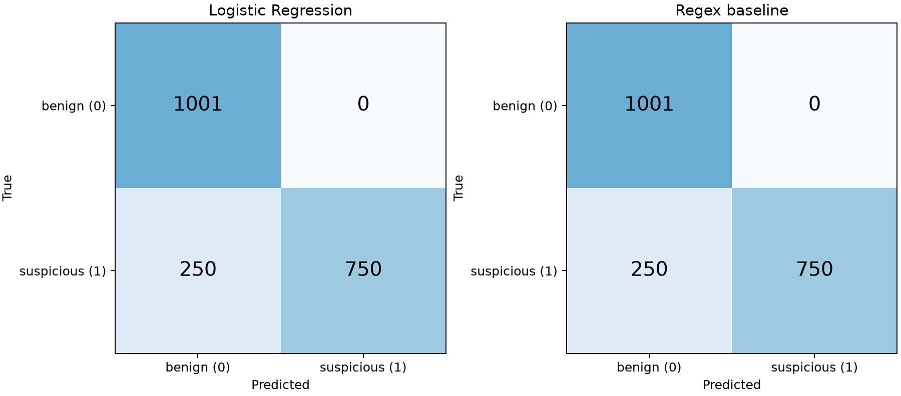
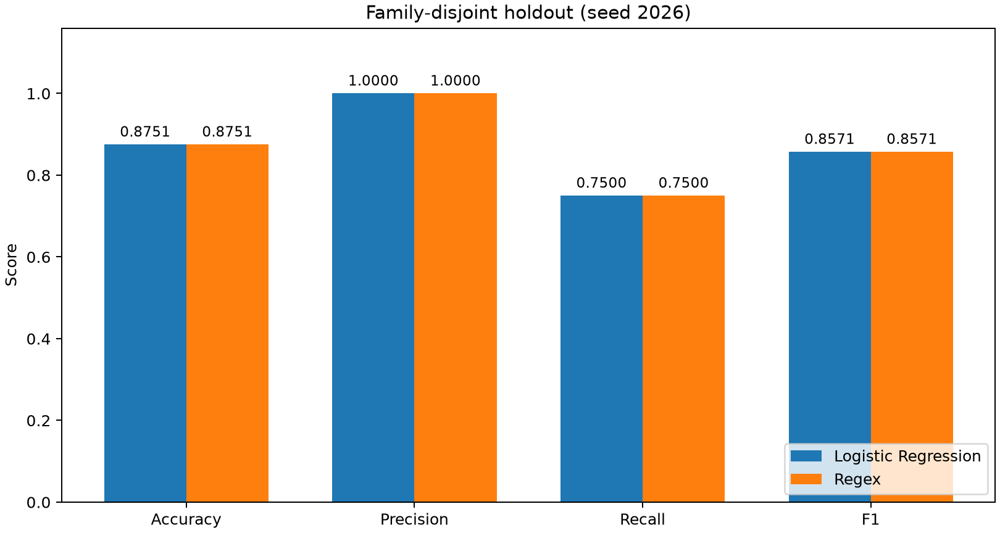
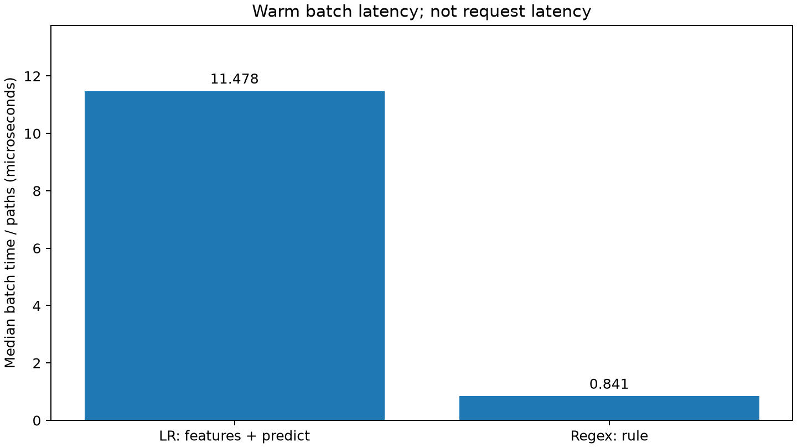

# Thực nghiệm đánh giá Logistic Regression và regex

Ngày thực hiện: **16/11/2026, khoảng 22:32–22:37 (Asia/Saigon)**.
Tất cả số liệu dưới đây lấy từ chương trình đã chạy. Model đang phục vụ
download và CSV cũ được giữ nguyên, xác minh bằng SHA-256 trước/sau.

## Bộ kết quả chính

Lần chạy chính thức sau hoàn thiện công cụ:
`20261116T153450Z_e5b13b`.
Lần chạy ban đầu `20261116T153255Z_aba50a` được giữ lại để đối chiếu;
không chọn model dựa trên kết quả cao hơn. Cả hai dùng cùng seed chính,
chỉ số phân loại giống nhau; thời gian có dao động giữa các lần đo.

- [Báo cáo chi tiết tự sinh](evaluations/20261116T153450Z_e5b13b/REPORT.md).
- [Kết quả JSON đầy đủ](evaluations/20261116T153450Z_e5b13b/results.json).
- [Phân train/test từng mẫu](evaluations/20261116T153450Z_e5b13b/split.csv).
- [Dự đoán từng mẫu test](evaluations/20261116T153450Z_e5b13b/predictions.csv).
- [Manifest SHA-256](evaluations/20261116T153450Z_e5b13b/manifest.json).
- [Danh sách toàn bộ file tạo/sửa](AI_EXPERIMENT_FILES.md).

## Kiểm tra dữ liệu và phương pháp

10.000 dòng, 10.000 đường dẫn duy nhất; **0 dòng trùng dư, 0 nhóm trùng,
0 đường dẫn xung đột nhãn**. Nhãn benign=0: 5.000, suspicious=1: 5.000.
35 family gồm 15 nhóm benign và 20 nhóm suspicious; số lượng từng nhóm
có trong báo cáo và JSON. Family được cung cấp bởi bộ sinh dữ liệu, không
phải nhóm được học từ nhãn test.

Giữ cách chia theo family với seed **2026**: train **7.999** mẫu/28 family,
test **2.001** mẫu/7 family. Train: 3.999 benign + 4.000 suspicious;
test: 1.001 benign + 1.000 suspicious. Không giao nhau family hoặc chuỗi
đường dẫn giữa train và test. Kiểm tra tự động dừng nếu có giao nhau.

StandardScaler chỉ fit train; LR cũng chỉ fit train. Dùng cấu hình cố định
`max_iter=1000`, `class_weight=balanced`, ngưỡng 0,5; không tuning trên test.
Regex dùng nguyên `simple_rule` để so sánh trên đúng các mẫu test của LR.

Có **29 vector đặc trưng duy nhất** cùng xuất hiện ở train và test, do
nhiều chuỗi khác nhau được nén thành cùng 18 đặc trưng. Không khẳng định
family holdout tạo độc lập ngữ nghĩa tuyệt đối; các family vẫn dùng chung
bộ sinh và từ vựng. Chưa có test bên ngoài bộ sinh.

## Chỉ số thực tế trên holdout chính

| Phương pháp | Accuracy | Precision | Recall | F1 |
|---|---:|---:|---:|---:|
| Logistic Regression | 0,875062 | 1,000000 | 0,750000 | 0,857143 |
| Regex | 0,875062 | 1,000000 | 0,750000 | 0,857143 |

Confusion matrix cho cả hai: hàng là nhãn thật, cột là nhãn dự đoán,
thứ tự `[benign=0, suspicious=1]`: **`[[1001, 0], [250, 750]]`**.





250 false negatives đều thuộc family `1-16`, dạng
`%252e%252e%252f{f}`. Nhóm này là mẫu lexical nghi vấn trong bộ dữ liệu;
việc classifier bỏ sót không đồng nghĩa cơ chế kiểm soát file cho phép
đọc ngoài kho. `security.py` vẫn từ chối escape cấu trúc còn sót lại.

Không có bằng chứng LR tốt hơn regex trong holdout chính. Recall 75%
chưa đạt mục tiêu 95%; không được trình bày là đạt chỉ tiêu.

## Đo tốc độ

15 lượt warm batch, mỗi batch 2.001 mẫu; warmup không tính vào số đo.

| Phép đo | Median batch (ms) | P95 batch (ms) | Median µs/path (chia từ batch) |
|---|---:|---:|---:|
| LR suy luận, đặc trưng tính sẵn | 0,273900 | 0,315710 | 0,136882 |
| LR trích đặc trưng + suy luận | 22,966600 | 24,331300 | 11,477561 |
| Regex đầu cuối | 1,683800 | 2,264140 | 0,841479 |



Trong lần đo này LR gồm trích đặc trưng chậm hơn regex khoảng **13,64 lần**.
Không so inference-only của LR với regex đầu cuối để khẳng định ưu thế.
P95 ở đây tính trên thời gian batch, không phải percentile từng request.
Không gồm CSV I/O, Flask, SQLite, network hoặc quá trình truyền tệp.
Môi trường và số đo thô được lưu để tái lập, không dùng làm cam kết tốc độ.

## Tổng quát hóa sang family chưa gặp

Đánh giá thêm bốn seed định sẵn ngoài seed chính, mỗi seed tạo pipeline
mới. Không chọn seed tốt nhất và không đưa model phụ lên ứng dụng.

| Seed | LR Recall | LR F1 | Regex Recall | Regex F1 |
|---|---:|---:|---:|---:|
| 2026 | 0,750000 | 0,857143 | 0,750000 | 0,857143 |
| 7 | 0,992000 | 0,995984 | 1,000000 | 1,000000 |
| 42 | 1,000000 | 1,000000 | 1,000000 | 1,000000 |
| 123 | 1,000000 | 1,000000 | 1,000000 | 1,000000 |
| 2025 | 0,500000 | 0,665779 | 1,000000 | 1,000000 |

LR Recall biến động 50–100%, cho thấy phụ thuộc mạnh vào family test.
Các lượt chia lại có tái sử dụng mẫu giữa các lượt; không coi là năm tập
test độc lập hoặc bằng chứng đã đạt recall ổn định. Regex tốt hơn LR
trên một số lượt ở tập tổng hợp này.

Dữ liệu cân bằng nhân tạo không phản ánh tỷ lệ tấn công trong traffic
thật. Tên tệp nhạy cảm có thể gắn với nhãn do cách sinh; các family
tương tự nhau dù không trùng ID. Cần nguồn độc lập, benign khó,
payload obfuscation chưa có trong generator, nhãn được kiểm tra và tập
test khóa theo nguồn/thời gian trước tuning để kết luận tổng quát hóa.

## Dashboard và xác minh hồi quy

Sau đăng nhập, mở dashboard và chọn **Kết quả đánh giá AI**:
`/dashboard/ai-evaluation`. Trang đọc artifact mới nhất, hiển thị audit,
metrics, confusion matrix, timing và các ảnh PNG. Ảnh được phục vụ cùng
origin, yêu cầu đăng nhập; endpoint chỉ cho phép ba tên PNG cố định,
không cho tải model. Nếu chưa có kết quả hợp lệ, trang hiển thị thông báo
và dashboard nhật ký vẫn hoạt động. Không chạy huấn luyện trong request.

Kết quả kiểm thử:

- **Pytest: 42 passed, 3 skipped, 15 subtests passed**, không FAIL;
  nâng `InconsistentVersionWarning` thành lỗi. Ba SKIP vẫn là thiếu quyền
  symlink Windows, không đánh dấu PASS.
- Các test mới xác minh thống kê scaler bằng chính train; tính lại metrics
  từ prediction CSV; checksum artifact; PNG; xác thực trang và fallback
  khi pointer thiếu/hỏng hoặc chứa đường dẫn không hợp lệ.
- **HTTP qua TCP: 14 PASS, 0 FAIL**: đăng nhập/đăng xuất, trang mới,
  đúng byte ba PNG, từ chối tải model, dashboard cũ, download 200/403/404.
  Database kiểm thử riêng; không ghi vào nhật ký sử dụng thật.

Bằng chứng:
[pytest.txt](evaluations/pytest.txt), [JUnit XML](evaluations/pytest.xml),
[TCP dashboard](evaluations/dashboard_http_20261116T153450Z_e5b13b.json).

## Tái lập

Chạy từ `FileGuardAI_H07`, sử dụng môi trường `.venv` hiện tại ở thư mục cha:

```powershell
..\.venv\Scripts\python.exe -m ml.evaluate --repeats 15
..\.venv\Scripts\python.exe tools/verify_evaluation_http.py
..\.venv\Scripts\python.exe -m pytest -q -rs -W error::sklearn.exceptions.InconsistentVersionWarning
```

Nếu dùng môi trường `.venv` nằm ngay trong dự án, thay prefix bằng
`.\.venv\Scripts\python.exe`. Cài phụ thuộc từ `requirements.txt` trước
khi chạy ở môi trường mới; matplotlib đã được bổ sung vào danh sách.

Lệnh đánh giá đọc dữ liệu hiện có, tạo thư mục timestamp/UUID mới dưới
`docs/evaluations`, lưu model đánh giá riêng và cập nhật `latest.json` cho
dashboard. Không gọi bộ sinh để thay dữ liệu, không ghi đè model triển khai
hoặc xóa lần thực nghiệm cũ.
