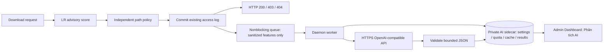

# Phân tích AI bổ sung qua OpenAI-compatible — 17/11/2026

## Cách dùng, mặc định offline

Logistic Regression và chính sách Path Traversal vẫn xử lý download như trước. Dịch vụ API chỉ nhận việc **sau khi quyết định đã được xác lập và access_log được commit**. API không cấp quyền, không sửa ALLOW/BLOCK/MISS, không fit hoặc thay artifacts/model.joblib. Không có key/model, cấu hình sai hoặc Admin chưa bật: xử lý cục bộ, không có lời gọi API. Không tạo lời giải thích giả khi offline.

Adapter hiện có là HTTPS Chat Completions OpenAI-compatible. Operator chọn endpoint và model được tài khoản nhà cung cấp cho phép; không đoán model mặc định. Giao thức tham chiếu [OpenAI Chat API chính thức](https://developers.openai.com/api/reference/resources/chat). Các nhà cung cấp phải hỗ trợ model/messages, max_completion_tokens và store=false cùng response choices[].message.content; adapter không tuyên bố tương thích mọi SDK/vendor native. Có thể thay adapter Python độc lập qua AI_EXPLANATION_ADAPTER (identity + analyze(features)), không phải nhập endpoint tùy ý trên web.

Chỉ đọc biến môi trường của process. `.env.example` là danh mục biến, không có secret; `python run.py` **không tự nạp .env**. Nếu dùng .env, operator phải nạp riêng vào environment và giữ file ngoài Git. Thiết lập PowerShell bằng nhập kín:

```powershell
$aiKeySecure = Read-Host 'API key (khong gui vao chat/Git)' -AsSecureString
$aiKeyPtr = [Runtime.InteropServices.Marshal]::SecureStringToBSTR($aiKeySecure)
try { $env:AI_EXPLANATION_API_KEY = [Runtime.InteropServices.Marshal]::PtrToStringBSTR($aiKeyPtr) }
finally { [Runtime.InteropServices.Marshal]::ZeroFreeBSTR($aiKeyPtr) }
$env:AI_EXPLANATION_PROVIDER = 'openai-compatible'
$env:AI_EXPLANATION_ENDPOINT = 'https://api.openai.com/v1/chat/completions'
$env:AI_EXPLANATION_MODEL = 'THAY_BANG_MODEL_DUOC_CAP_QUYEN'
$env:AI_EXPLANATION_TIMEOUT = '3'
$env:AI_EXPLANATION_HOURLY_LIMIT = '20'
python run.py
```

Thay MODEL bằng ID thực của nhà cung cấp, không dùng placeholder. Không in hoặc đưa key vào shell command literal/history. Restart sau khi đổi environment. Đăng nhập Admin → Dashboard → **Phân tích AI** → chọn **Bật** → **Lưu cấu hình** (POST+CSRF). Đây là đồng ý gửi đặc trưng làm sạch. Gây cảnh báo bằng yêu cầu tải như bình thường, tải lại Dashboard để xem kết quả nền. Chỉ hiển thị trạng thái đã cấu hình, không render key/endpoint/model vào HTML/JS. Trạng thái configured chỉ có nghĩa cấu hình hiện diện/đúng định dạng, không chứng minh key/model đã được nhà cung cấp chấp nhận.

Admin có thể tắt bất kỳ lúc nào; preference tồn tại qua restart. Thiếu key/model vẫn offline dù preference Bật. Tắt giữ kết quả lịch sử; tác vụ đã được chấp nhận/gửi trước đó có thể hoàn tất, không thể thu hồi dữ liệu đã gửi. Guest/Auditor không lưu cấu hình hoặc xem Dashboard; quyền cũ giữ nguyên.

## Luồng và ranh giới dữ liệu



Không có network, SQLite sidecar hoặc chờ API trong download thread. Chỉ tính tám đặc trưng trên tối đa4096 ký tự rồi queue.put_nowait. Nhận BLOCK hoặc nhãn LR suspicious (kể cả ALLOW/MISS); benign ALLOW không gửi. Queue chỉ có numeric event_id nội bộ và các trường sau; **event_id không ra API**:

| Trường outbound | Dạng dữ liệu |
|---|---|
| decision | ALLOW/BLOCK/MISS đã chốt |
| ml_alert | boolean |
| parent_components | số thành phần .., chặn trên4 |
| absolute_style | boolean, không có drive letter |
| backslash | boolean |
| structural_encoding | boolean |
| remaining_decode_changes |0–2 lượt unquote còn làm thay đổi chuỗi |
| length_bucket |short/medium/long, không gửi độ dài chính xác |

Không gửi raw path, tên file/thư mục/extension, IP khách, lý do OS có thể chứa path, mật khẩu, session/CSRF/user token, file handle hoặc nội dung file. Hai lượt unquote này chỉ phục vụ audit đặc trưng, **không đổi quy tắc decode của policy**. Input là giá trị Flask đã decode transport một lần, nên không suy ra chính xác số lớp encoding gốc. Các cờ không đủ biết mọi nguyên nhân như symlink hoặc trạng thái filesystem; phải đối chiếu lý do backend cục bộ, không lấy lời giải thích LLM làm chứng cứ khai thác.

API key chỉ đi trong Authorization header HTTPS đến endpoint đã cấu hình; không nằm trong prompt, queue, sidecar hoặc browser. Đây là key xác thực provider, không phải token người dùng. Endpoint phải HTTPS, không chứa userinfo/query/fragment; không theo redirect để tránh chuyển header key sang host khác. TLS dùng kiểm tra chứng chỉ mặc định. Nhà cung cấp vẫn thấy địa chỉ mạng máy chủ và account API; cờ store=false không thay thế cam kết lưu giữ dữ liệu của vendor. Response có echo key rõ hoặc JSON-escaped bị loại.

Kết quả chỉ bốn trường JSON: why, traversal_type, risk (low/medium/high/unknown), recommendations. Giới hạn response64KiB, chuỗi1200/150/1600 ký tự; schema dư/sai hoặc dữ liệu lỗi bị từ chối. Jinja autoescape, không Markdown/HTML execution. Rủi ro là tham khảo do mô hình ngôn ngữ sinh, không phải xác suất LR hay số liệu thực nghiệm. Kết quả theo nhóm đặc trưng không đủ xác định ý định hoặc thành công của một payload cụ thể.

## Tách lưu trữ, hạn mức và lỗi

Dùng SQLite phụ `instance/ai_explanations.sqlite3` theo thư mục DATABASE, cấu hình AI_EXPLANATION_DATABASE khi cần. Không cho dùng cùng file business DATABASE hoặc đặt trong FILES_ROOT. Tạo lazy, không đổi schema business; insert_log chỉ thêm return lastrowid để liên kết. Bảng phụ settings/calls/cache/analyses dùng bound parameters, không chứa key/raw path/IP/file. ID hiển thị cạnh path trong nhật ký để đối chiếu với summary phân tích; danh sách20 kết quả API gần nhất **toàn hệ thống**, độc lập bộ lọc log, ghi rõ trên UI.

- Một worker daemon/process, queue tối đa16; đầy hoặc I/O lỗi thì bỏ qua giải thích, vẫn trả HTTP theo policy. Counter local dropped là vận hành của process, không phải chỉ số phát hiện tấn công.
- Mặc định20 lượt đặt chỗ API/giờ dùng chung qua SQLite BEGIN IMMEDIATE; config clamp1–100. Thất bại/hủy sau đặt chỗ vẫn tiêu budget (giới hạn bảo thủ). Mỗi việc tối đa một call, không auto retry. Người gửi nhiều cảnh báo có thể làm cạn budget; không đảm bảo mỗi alert có giải thích.
- Cache24 giờ theo fingerprint của provider endpoint/model + đặc trưng làm sạch; không hash raw path. Dedup in-flight trong30 giây; lỗi cùng fingerprint có cooldown60 giây. Đổi provider/model không trộn cache. Không tự xóa history; operator cần kế hoạch dung lượng/backup sidecar riêng, business backup cũ không tự bao gồm nó.
- Timeout socket mặc định3s, clamp0,1–10s; DNS và peer nhỏ giọt không phải hard deadline toàn cục. Worker có thể kẹt lâu hơn nhưng không chờ trong download thread; queue/budget vẫn hữu hạn. Không tuyên bố SLA latency hoặc distributed durable job queue.
- HTTP429→quota,401/403→authentication, network/timeout/invalid_response/provider_error được lưu bằng mã cố định. Không log/persist exception text, headers hoặc raw API body. Lỗi đọc sidecar trên Dashboard hiện unavailable; worker lỗi tăng dropped, không sửa access log.
- Hàng đợi trong RAM best effort: restart có thể mất việc chưa nhận và trạng thái pending cũ được trình bày interrupted sau30s. Không backfill log cũ, không cam kết exactly-once. Khởi tạo app sau fork/per-worker; preloaded pre-fork WSGI và multi-host/network filesystem chưa được chứng nhận. Windows11 localhost là phạm vi demo.

## Kiểm thử thực tế

**Chưa gọi API nhà cung cấp thật, chưa có key/model thực để kiểm chứng online.** Transport tests giả lập success/network/timeout/401/429/invalid data; browser dùng adapter giả lập ghi rõ trong nội dung và metadata. Không coi fixture là phản hồi thật từ OpenAI hoặc số liệu chất lượng AI.

| Bộ kiểm thử | Kết quả |
|---|---|
| Pytest cuối |241 PASS,0 FAIL,0 ERROR,3 SKIP;15 subtests PASS;114,56s |
| Acceptance sau sửa cổng TCP |6/6 bước exit0;pytest241 PASS/3 SKIP |
| Dashboard TCP |41 PASS,0 FAIL |
| Download TCP fixture |33 PASS,0 FAIL,3 symlink SKIP;port55053 do OS cấp |
| Hiệu năng |144 request/144 dòng SQLite fixture,0 lỗi |
| Edge browser cuối |448 PASS,0 FAIL,0 JS/static errors |

[Pytest](../ui/pytest_20261117T143949Z/stdout.txt) · [Acceptance cuối/JUnit](../bao_cao_h07/evidence/20261117T144501Z_7d3f31/summary.json) · [Browser cuối](../ui/browser_20261117T143825Z_63a207/results.json) · [Ảnh fixture Light](../ui/browser_20261117T143825Z_63a207/ai_analysis_mock_light.png) · [Ảnh fixture Dark](../ui/browser_20261117T143825Z_63a207/ai_analysis_mock_dark.png).

27 cases mới: privacy allowlist, HTTPS endpoint constraints, provider success/mất mạng/timeout/quota/invalid JSON/key echo, worker failure offline, UI escaping, không key, CSRF/Admin/Auditor/Guest, block giữ nguyên với mọi API outcome, high LR vẫn ALLOW200/MISS404, worker chậm không chặn response, queue bounded, cache/shared quota/toggle/cooldown và sidecar isolation/outage. Browser thêm9 checks: preference mặc định tắt, form CSRF, enable, HTTP403 hoàn tất trước provider release, không raw/IP trong payload, hoàn tất nền, render mock, quota vẫn403 và disable dừng call. Giữ439 checks thương hiệu/AI Training/đăng nhập/đổi mật khẩu/theme/cỡ chữ/Chart.js/download. Chrome CI chạy cùng suite, công bố riêng theo commit trên PR; Chrome local vẫn có giới hạn crash cũ. Zoom125–200% vẫn là reflow CDP mô phỏng, chưa xác minh native browser zoom.

Ba SKIP local vẫn do quyền symlink Windows, không chuyển thành PASS. Data10.000 mẫu và deployed/frozen model hashes không đổi qua các lượt. Lượt acceptance cuối xác nhận hash SQLite nghiệp vụ không đổi **trong lượt chạy đó**, nhưng toàn đợt có sự cố tác động log thật như dưới đây.

## Sự cố kiểm thử cổng5000 — giữ nguyên bằng chứng

Lượt [143746Z](../bao_cao_h07/evidence/20261117T143746Z_9096a8/summary.json) có download_tcp exit1:33 FAIL/3 SKIP. TC HTTP/content đúng nhưng DB fixture không có dòng nào. Bộ cũ bind/request cố định localhost5000 có dấu hiệu đi vào server khác, cùng lúc hash `instance/events.sqlite3` thay đổi từ10546f26... sangd54ef2a1.... Query **chỉ đọc** trong khoảng14:40:30–14:40:31 UTC thấy38 dòng,35 dòng có path trùng đầu vào test (ID nhỏ nhất32, lớn nhất69); không khẳng định mọi dòng đồng thời đều do test nếu người dùng cũng truy cập. [Quan sát tổng hợp](evidence/port_collision.json) không xuất IP hoặc raw business paths.

Đã giữ nguyên toàn bộ log và dữ liệu, không xóa/rollback để làm đẹp hash. Không kill server người dùng. Sửa tools/verify_tcp.py bind port0 và dùng đúng server.server_port cho mọi request; smoke_http nhận --port, mặc định standalone5000 vẫn tương thích. Acceptance truyền explicit cổng fixture; các assertions một SQLite row/IP/path/score/HTTP vẫn giữ. Lượt cuối port55053 đạt33 PASS/3 SKIP và protected_unchanged business DB=true. Vì có lượt trước tác động log thật, **không tuyên bố business SQLite không đổi cho toàn đợt**.

Các lượt khác: acceptance142803Z đạt6 bước (mốc235 tests); browser142753Z27 PASS/1 FAIL do selector bộ lọc trùng form settings mới, scope đúng form#action rồi chạy lại; browser143108Z448 PASS trước guard/ghi chú cuối; browser143825Z448 PASS cuối. Giữ cả kết quả lỗi/trung gian. Không đổi FAIL thành SKIP.

## File và vận hành

Source: `app/ai_explanations.py` (mới), `app/web.py` (factory/service/submit sau commit/settings), `app/database.py` (return ID, schema cũ giữ nguyên), `app/templates/_ai_analysis.html` (mới), `dashboard.html` (panel và event ID). Tests/tools: `tests/test_ai_explanations.py` (mới), `tools/ui_ai_analysis_checks.py` (mới), `tools/verify_ui_browser.py`, `tools/verify_tcp.py`, `tools/smoke_http.py`. Config/docs: `.env.example` không có secret, `.gitignore` thêm sidecar journal, README/UI README/PR description và báo cáo/evidence này.

Chạy `python -m pytest -q -rs`, `python tools/run_h07_acceptance.py`. Browser tùy chọn `python tools/verify_ui_browser.py --browser "đường dẫn Chrome/Edge.exe"` chỉ dùng fake adapter và fixture riêng, không gọi API thật dù môi trường có key. TESTING mặc định không tạo adapter mạng từ env; unit inject rõ provider/transport giả. Không sửa password, policy, dataset/model/experimental results hoặc commit SQLite/keys. Nhánh h07/cybersecurity-ui, PR#2 draft, không merge main.
