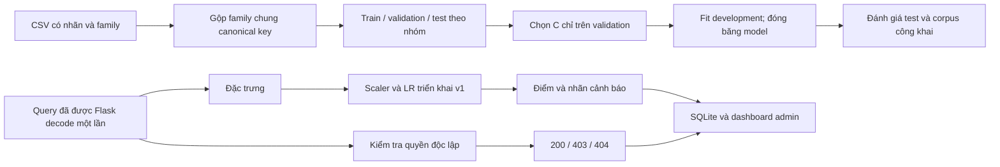

# 02 — Quy trình AI và đặc trưng

Bản nghiệm thu ngày 17/11/2026 (giờ Việt Nam). Phạm vi: MVP localhost Windows 11; không phải chứng nhận triển khai Internet.

Logistic Regression: z=wᵀx+b, P(suspicious)=1/(1+exp(-z)); ngưỡng cố định0.5. Pipeline chuẩn hóa StandardScaler trước LR; chỉ fit trên phần development được phép. Đây là xác suất của nhãn tổng hợp trong phân phối huấn luyện, chưa được hiệu chỉnh thành xác suất khai thác thật.

V1 có18 đặc trưng, giữ tương thích artifact đang triển khai. V2 thêm12 đặc trưng cực đại trên raw, decode1, decode2; chỉ tạo góc nhìn ML, không truyền chuỗi giải mã này tới filesystem. Không dùng `unquote_plus` ở bước ML, không lặp tới khi ổn định. Số thành phần cha và độ sâu thoát đo trên cả `/` và `\`; escape ký tự cấu trúc và số lần decode thay đổi giúp nhận double encoding.

| STT | Đặc trưng trong mã | Phạm vi |
|---|---|---|
| 1 | `length` | v1 + v2 |
| 2 | `depth_slash` | v1 + v2 |
| 3 | `backslashes` | v1 + v2 |
| 4 | `dotdot` | v1 + v2 |
| 5 | `percent_count` | v1 + v2 |
| 6 | `encoded_dot` | v1 + v2 |
| 7 | `encoded_slash` | v1 + v2 |
| 8 | `encoded_backslash` | v1 + v2 |
| 9 | `leading_slash` | v1 + v2 |
| 10 | `drive_prefix` | v1 + v2 |
| 11 | `contains_colon` | v1 + v2 |
| 12 | `spaces` | v1 + v2 |
| 13 | `non_ascii` | v1 + v2 |
| 14 | `digits` | v1 + v2 |
| 15 | `multiple_dots` | v1 + v2 |
| 16 | `null_encoding` | v1 + v2 |
| 17 | `contains_question` | v1 + v2 |
| 18 | `entropy` | v1 + v2 |
| 19 | `view_max_parent_components` | v2 thử nghiệm |
| 20 | `view_max_parent_fraction` | v2 thử nghiệm |
| 21 | `view_max_rooted` | v2 thử nghiệm |
| 22 | `view_max_drive` | v2 thử nghiệm |
| 23 | `view_max_unc` | v2 thử nghiệm |
| 24 | `view_max_separators` | v2 thử nghiệm |
| 25 | `view_mixed_separators` | v2 thử nghiệm |
| 26 | `view_max_escape_depth` | v2 thử nghiệm |
| 27 | `view_max_dot_components` | v2 thử nghiệm |
| 28 | `view_max_null` | v2 thử nghiệm |
| 29 | `view_max_structural_escapes` | v2 thử nghiệm |
| 30 | `decode_changes` | v2 thử nghiệm |

Length/count/entropy là tín hiệu thống kê, không phải bằng chứng quyền. Hệ số đọc từ artifact thật qua trang AI Training; hệ số trên không gian đã chuẩn hóa, không diễn giải thành quan hệ nhân quả. Không thay pipeline v1 tại runtime bằng v2.

Nguồn: [ml_features.py](../../app/ml_features.py), [strict_groups.py](../../ml/strict_groups.py), [script đánh giá](../../tools/evaluate_strict_groups.py), [đánh giá và giới hạn](10_DANH_GIA_MO_HINH.md).

**Trạng thái: PASS.** Đối chiếu [ma trận tổng hợp](12_MA_TRAN_NGHIEM_THU.md). Bằng chứng chạy thực tế: [summary](evidence/20261116T182248Z_5acba3/summary.json), [pytest](evidence/20261116T182248Z_5acba3/pytest.stdout.txt), [bảng HTTP](evidence/20261116T182248Z_5acba3/http_test_cases.csv).
