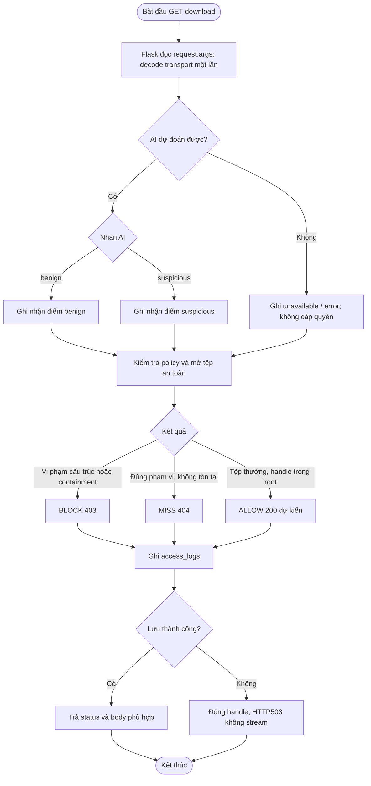

# 03 — UML Activity của yêu cầu tải tệp

Bản nghiệm thu ngày 17/11/2026 (giờ Việt Nam). Phạm vi: MVP localhost Windows 11; không phải chứng nhận triển khai Internet.

False negative AI vẫn403 nếu policy bị vi phạm; false positive với tệp hợp lệ vẫn200. Không tồn tại trong root vẫn404 kể cả điểm AI cao. Lỗi cơ sở dữ liệu không được báo nhầm404 và không stream tệp rồi mới thử ghi log. Không bảo đảm có bản ghi SQL trong thời gian SQLite không hoạt động: lỗi được ghi vào server logger, trả503.

Kiểm chứng [test_app.py](../../tests/test_app.py), [test_acceptance_extensions.py](../../tests/test_acceptance_extensions.py), và [TCP](06_MA_TRAN_KIEM_THU.md). Bản PlantUML lịch sử: [download_activity.puml](../h07/diagrams/download_activity.puml); sơ đồ ở đây bổ sung nhánh503 và là mô tả hiện hành.

**Trạng thái: PASS.** Đối chiếu [ma trận tổng hợp](12_MA_TRAN_NGHIEM_THU.md). Bằng chứng chạy thực tế: [summary](evidence/20261116T182248Z_5acba3/summary.json), [pytest](evidence/20261116T182248Z_5acba3/pytest.stdout.txt), [bảng HTTP](evidence/20261116T182248Z_5acba3/http_test_cases.csv).
