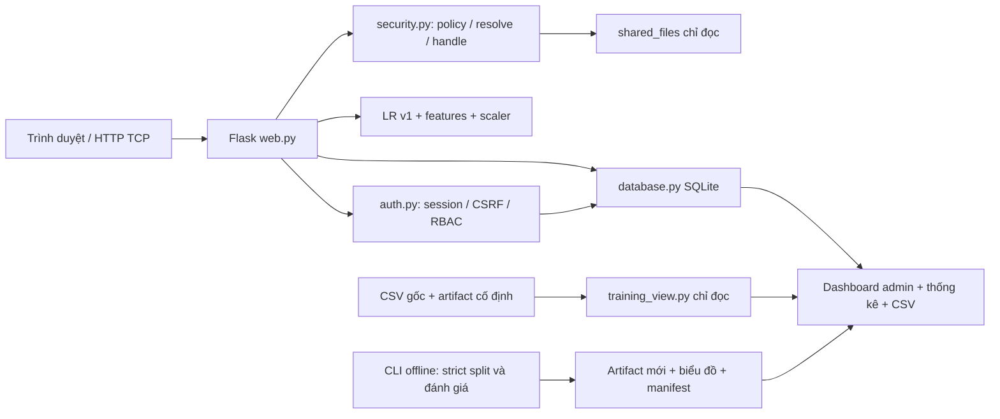

# 04 — Kiến trúc và ranh giới tin cậy

Bản nghiệm thu ngày 17/11/2026 (giờ Việt Nam). Phạm vi: MVP localhost Windows 11; không phải chứng nhận triển khai Internet.

| Module | Đầu vào | Đầu ra / trách nhiệm |
|---|---|---|
| web | Request đã parse | Điều phối tải tệp, đăng nhập, log, render; không fit model |
| security | Root tin cậy + đường dẫn | Handle tệp an toàn hoặc lỗi policy/missing |
| ml_features / predictor | Chuỗi | Vector18 / xác suất; v2 chỉ thử nghiệm |
| auth | Form/session/config hash | Role; CSRF; throttle; expiry |
| database / log_filters | Giá trị đã kiểm tra | INSERT và SELECT bind tham số; hai bảng append-only |
| training_view | CSV và artifact được cấu hình cố định | Thống kê, hệ số thật, lịch sử; không triển khai |
| tools / ml | CSV có nhãn gốc | Đánh giá offline, hình PNG, bằng chứng tái lập |

Đồng bộ theo từng request: AI/policy/SQLite xong trước response. Dashboard cập nhật khi tải lại trang, không khẳng định realtime cứng hoặc xử lý packet mạng. Public root tách DB, dữ liệu huấn luyện, credential, model và evaluation root; startup từ chối cấu hình đặt private storage trong root. SQLite phù hợp demo đơn máy; Flask localhost không chứng minh khả năng chịu tải production. Biến môi trường/secret và ACL do người vận hành quản lý.

Triển khai, rollback, backup và bốn chương đã có: [runbook](../h07/AN_NINH_VAN_HANH.md), [Chương1](../h07/CHUONG_1.md), [Chương2](../h07/CHUONG_2.md), [Chương3](../h07/CHUONG_3.md), [Chương4 lịch sử](../h07/CHUONG_4.md). Bổ sung thực nghiệm mới dùng tài liệu10–12 thay số cũ; không xóa các lần chạy trước.

**Trạng thái: PASS.** Đối chiếu [ma trận tổng hợp](12_MA_TRAN_NGHIEM_THU.md). Bằng chứng chạy thực tế: [summary](evidence/20261116T182248Z_5acba3/summary.json), [pytest](evidence/20261116T182248Z_5acba3/pytest.stdout.txt), [bảng HTTP](evidence/20261116T182248Z_5acba3/http_test_cases.csv).
