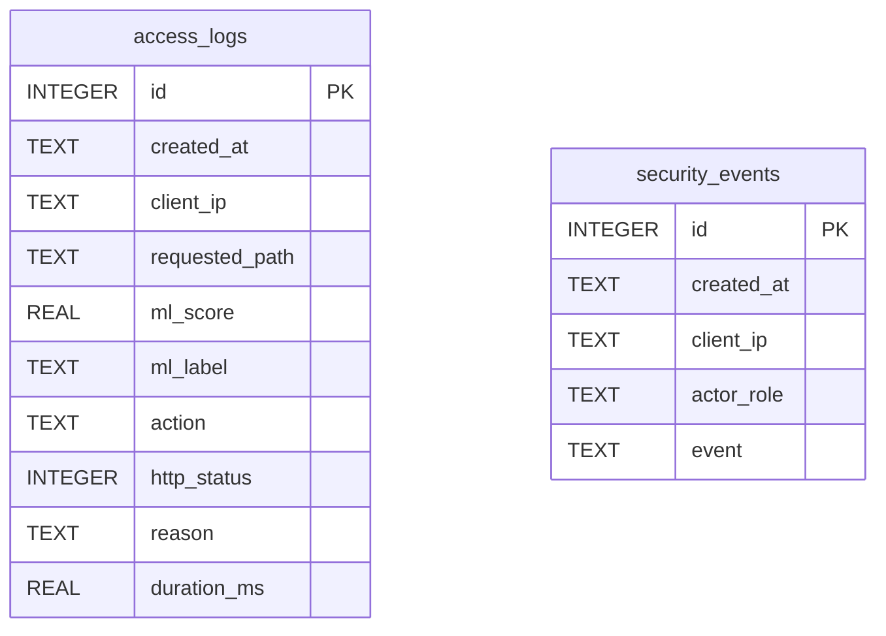

# 05 — SQLite, ERD và bảo vệ nhật ký

Bản nghiệm thu ngày 17/11/2026 (giờ Việt Nam). Phạm vi: MVP localhost Windows 11; không phải chứng nhận triển khai Internet.



Hai bảng độc lập, không có khóa ngoại giả định giữa request và session. ID tự tăng; các cột ngoài ml_score đều NOT NULL. Thời gian UTC ISO giây; score có thể NULL khi AI không khả dụng. ALLOW→200, BLOCK→403, MISS→404; kiểm tra cặp action/status, nhãn whitelist, probability hữu hạn0..1, duration hữu hạn không âm trước INSERT. Chuỗi path được giới hạn4096. IP lấy theo request, không tin tùy tiện X-Forwarded-For.

Index: `access_logs(created_at)` và `security_events(client_ip,created_at)`. Trigger chặn UPDATE/DELETE trên cả hai bảng. Không chống được chủ sở hữu file OS hoặc người gỡ trigger; DB/backup cần ACL riêng, không đặt trong root công khai. Không lưu mật khẩu, CSRF token hoặc session cookie trong bằng chứng.

Ví dụ truy vấn logic (giá trị dùng tham số, không nội suy):

```sql
SELECT * FROM access_logs
WHERE created_at >= ? AND created_at <= ?
  AND action = ? AND ml_label = ? AND http_status = ?
ORDER BY id DESC LIMIT ?;
```

Bộ lọc đồng thời thời gian UTC, quyết định, nhãn AI, HTTP áp dụng cùng điều kiện cho bảng, thẻ thống kê và export. Giới hạn bảng tối đa500; dashboard là mẫu gần nhất, số đếm là tập lọc. Input sai hoặc start>end trả400, không chạy câu SQL tự do. Trống trả0, không NULL.

`duration_ms` là thời gian xử lý đo trước INSERT/stream, không gồm tải body hoàn chỉnh. Latency TCP trong bài hiệu năng đo từ client đến nhận body xong, không so sánh như cùng đại lượng. Mất SQLite trả503 và giữ kín nội dung; login chỉ cấp session sau audit thành công; logout vẫn xóa session khi audit lỗi.

Đợt144 request có144 dòng, integrity_check=`ok`, trường IP/path/score/action/status/time được công cụ kiểm tra với request thực. Xem [hiệu năng](../h07/evidence/20261116T182323Z_0090f9/performance.json), [database.py](../../app/database.py), [tests mở rộng](../../tests/test_acceptance_extensions.py). Backup CLI [backup_logs.py](../../tools/backup_logs.py) dùng SQLite backup, không ghi đè bằng chứng cũ.

**Trạng thái: PASS.** Đối chiếu [ma trận tổng hợp](12_MA_TRAN_NGHIEM_THU.md). Bằng chứng chạy thực tế: [summary](evidence/20261116T182248Z_5acba3/summary.json), [pytest](evidence/20261116T182248Z_5acba3/pytest.stdout.txt), [bảng HTTP](evidence/20261116T182248Z_5acba3/http_test_cases.csv).
