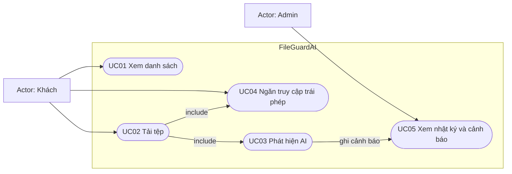

# 08 — Đặc tả Use Case

Bản nghiệm thu ngày 17/11/2026 (giờ Việt Nam). Phạm vi: MVP localhost Windows 11; không phải chứng nhận triển khai Internet.

Các ID sau là đặc tả hiện hành theo yêu cầu nghiệm thu; không dùng nhầm ID UC trong tài liệu lịch sử.

Đây là sơ đồ Use Case bằng Mermaid: các nút oval là chức năng trong boundary FileGuardAI; đường include thể hiện tải tệp luôn gọi AI và policy, không phải AI cấp quyền. Khách là tác nhân của yêu cầu, không có quyền cấu hình IPS.

## UC01 — Xem danh sách tệp

| Thuộc tính | Đặc tả |
|---|---|
| Actor | Khách |
| Tiền điều kiện | Public root tồn tại |
| Đầu vào | GET / |
| Luồng chính | Hiển thị tên/link tệp công khai đã escape HTML |
| Luồng thay thế / ngoại lệ | Không liệt kê DB/model/log; root lỗi hiển thị lỗi phù hợp |
| Hậu điều kiện | Không làm thay đổi tệp |
| Kiểm thử | tests/test_app.py; TCP public index |

## UC02 — Tải tệp hợp lệ

| Thuộc tính | Đặc tả |
|---|---|
| Actor | Khách |
| Tiền điều kiện | Tệp thường nằm trong root |
| Đầu vào | GET /download?path=tên tương đối |
| Luồng chính | Parse→AI→policy→mở an toàn→ghi ALLOW→200 đúng body |
| Luồng thay thế / ngoại lệ | Thiếu tệp404; policy403; DB lỗi503 |
| Hậu điều kiện | Không đọc ngoài root; ghi log nếu SQLite hoạt động |
| Kiểm thử | tests/test_app.py; verify_tcp valid/Unicode/subdir |

## UC03 — Phát hiện bằng AI

| Thuộc tính | Đặc tả |
|---|---|
| Actor | Hệ thống; admin xem |
| Tiền điều kiện | Artifact v1 tương thích hoặc chế độ unavailable |
| Đầu vào | Chuỗi đường dẫn đã parse |
| Luồng chính | Trích18 đặc trưng→scaler→LR→score/label→log |
| Luồng thay thế / ngoại lệ | Model lỗi không cấp quyền; high score vẫn có thể200/404 theo policy |
| Hậu điều kiện | Có điểm thật hoặc trạng thái lỗi, không giả điểm |
| Kiểm thử | tests/test_app.py; test_evaluation.py |

## UC04 — Ngăn truy cập trái phép

| Thuộc tính | Đặc tả |
|---|---|
| Actor | Khách tạo request; hệ thống chặn |
| Tiền điều kiện | Có root tin cậy |
| Đầu vào | ../, backslash, absolute, encoding, link ra ngoài |
| Luồng chính | Policy xác nhận vi phạm→BLOCK403→không stream |
| Luồng thay thế / ngoại lệ | AI benign vẫn chặn; symlink test thiếu quyền SKIP; lỗi audit503 |
| Hậu điều kiện | Không lộ sentinel ngoài root trong các test đã chạy |
| Kiểm thử | tests/test_security.py; test_windows_handle.py; verify_tcp |

## UC05 — Quản trị nhật ký

| Thuộc tính | Đặc tả |
|---|---|
| Actor | Admin |
| Tiền điều kiện | Đăng nhập admin; SQLite hoạt động |
| Đầu vào | GET dashboard và POST export có CSRF; filter UTC/action/AI/HTTP |
| Luồng chính | Kiểm quyền→validate filter→query bind→thẻ/chart/bảng; export có audit |
| Luồng thay thế / ngoại lệ | Guest chuyển login; auditor403; filter sai400; CSRF403; DB503 |
| Hậu điều kiện | Không sửa/xóa log; export chỉ đúng scope |
| Kiểm thử | tests/test_auth.py; test_acceptance_extensions.py; dashboard TCP |

UC06 bổ sung: admin mở AI Training chỉ đọc dataset/model/history, export CSV với CSRF; không có endpoint fit/deploy. Thất bại checksum v2 hiển thị unavailable, không nạp pickle tùy ý. UC07: login kiểm hash + throttle + ghi audit trước session; logout luôn xóa session. [Mã routes](../../app/web.py), [test mở rộng](../../tests/test_acceptance_extensions.py).

**Trạng thái: PASS.** Đối chiếu [ma trận tổng hợp](12_MA_TRAN_NGHIEM_THU.md). Bằng chứng chạy thực tế: [summary](evidence/20261116T182248Z_5acba3/summary.json), [pytest](evidence/20261116T182248Z_5acba3/pytest.stdout.txt), [bảng HTTP](evidence/20261116T182248Z_5acba3/http_test_cases.csv).
