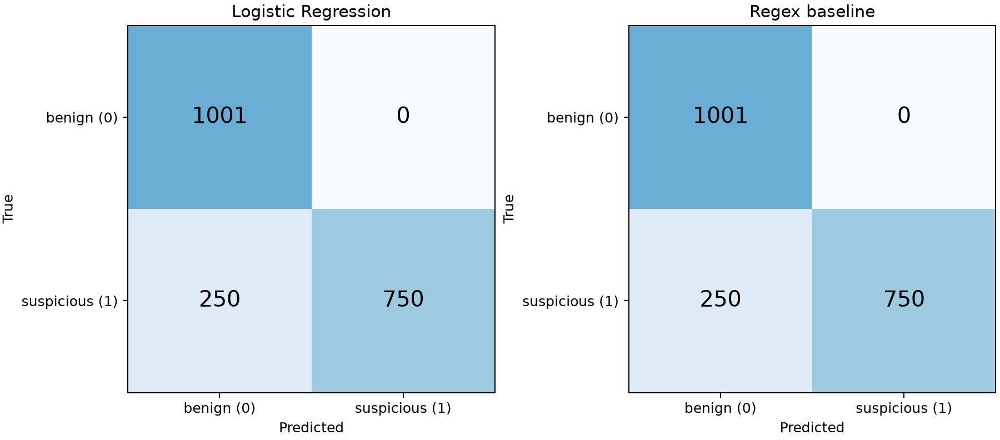
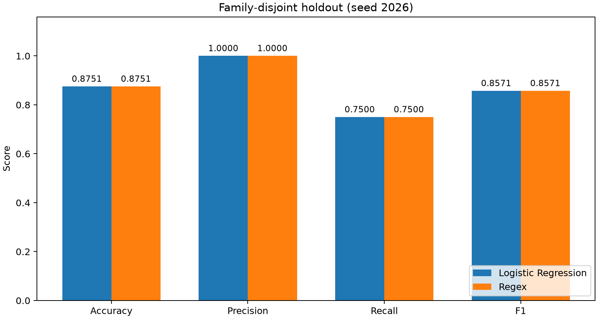
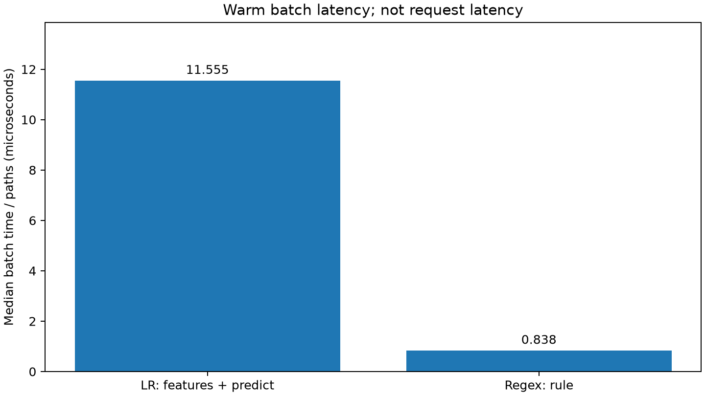

# Đánh giá thực nghiệm Logistic Regression — Chương 4

Thời điểm UTC: 2026-11-16T15:32:55.795204+00:00. Seed chính: 2026. Ngưỡng AI cố định 0,5.

## Dữ liệu và chống rò rỉ

CSV có 10000 mẫu, 10000 đường dẫn duy nhất, 0 dòng trùng dư, 0 nhóm đường dẫn trùng; 0 đường dẫn xung đột nhãn.
Nhãn: {'0': 5000, '1': 5000}. Có 35 family.
Train 7999, test 2001; train 28 family, test 7 family.
Family giao nhau: []; đường dẫn giao nhau: [].
Split stratify theo nhãn ở cấp family, xấp xỉ 20% số family mỗi nhãn làm test; không hứa chính xác 20% số dòng. StandardScaler và LR chỉ fit train. Không chọn ngưỡng/đặc trưng/siêu tham số theo test, không dùng test để huấn luyện.
Nhãn 1 là cú pháp nghi vấn, không phải bằng chứng đã đọc được tệp ngoài kho. Đầu vào CSV là chuỗi lexical, không phải toàn bộ HTTP query đã qua Flask decode.

| Phương pháp | Accuracy | Precision | Recall | F1 | TN | FP | FN | TP |
|---|---:|---:|---:|---:|---:|---:|---:|---:|
| logistic_regression | 0.875062 | 1.000000 | 0.750000 | 0.857143 | 1001 | 0 | 250 | 750 |
| regex | 0.875062 | 1.000000 | 0.750000 | 0.857143 | 1001 | 0 | 250 | 750 |

## Thời gian dự đoán

Fit model chính: 29.908 ms (không bao gồm trích đặc trưng). Benchmark warm batch, perf_counter_ns; có warmup, không gồm đọc CSV, I/O hay HTTP. So sánh đầu cuối LR gồm extract_features + predict_proba + ngưỡng; regex gồm simple_rule. LR inference-only dùng đặc trưng tính sẵn được báo riêng. Giá trị mỗi đường dẫn là thời gian batch chia số mẫu, không phải p95 latency của từng request.

| Phép đo | Số lượt | Median batch ms | P95 batch ms | Median µs/path (amortized) |
|---|---:|---:|---:|---:|
| lr_inference_only | 15 | 0.291200 | 0.517080 | 0.145527 |
| lr_end_to_end | 15 | 23.121600 | 25.303600 | 11.555022 |
| regex_end_to_end | 15 | 1.676000 | 2.110700 | 0.837581 |

## Độ nhạy với cách chọn family

Năm seed cố định được khai báo trước; mỗi lượt fit pipeline mới chỉ bằng train của lượt đó. Không chọn seed/model tốt nhất để triển khai. Các lượt có thể dùng lại mẫu ở vai trò train/test khác nhau nên không phải năm tập kiểm thử độc lập. Không dùng để tuning.

| Seed | Test rows | LR F1 | LR Recall | Regex F1 | Regex Recall |
|---|---:|---:|---:|---:|---:|
| 2026 | 2001 | 0.857143 | 0.750000 | 0.857143 | 0.750000 |
| 7 | 2000 | 0.995984 | 0.992000 | 1.000000 | 1.000000 |
| 42 | 1999 | 1.000000 | 1.000000 | 1.000000 | 1.000000 |
| 123 | 2000 | 1.000000 | 1.000000 | 1.000000 | 1.000000 |
| 2025 | 2001 | 0.665779 | 0.500000 | 1.000000 | 1.000000 |

## Phân tích lỗi theo family

| Family test | N | Nhãn | LR sai | Regex sai |
|---|---:|---:|---:|---:|
| 0-01 | 334 | 0 | 0 | 0 |
| 0-02 | 334 | 0 | 0 | 0 |
| 0-11 | 333 | 0 | 0 | 0 |
| 1-03 | 250 | 1 | 0 | 0 |
| 1-10 | 250 | 1 | 0 | 0 |
| 1-14 | 250 | 1 | 0 | 0 |
| 1-16 | 250 | 1 | 250 | 250 |

## Hạn chế và khả năng tổng quát hóa

- Dữ liệu tổng hợp từ số template hữu hạn, cân bằng 50/50; tên tệp và nhãn có thể tương quan do bộ sinh (ví dụ tên sensitive). Không đại diện phân bố traffic thực tế.
- Family holdout giảm ghi nhớ template giống hệt nhưng các family vẫn dùng chung cấu trúc, từ vựng và số ngẫu nhiên. Không có giao nhau chuỗi không có nghĩa các mẫu độc lập về ngữ nghĩa. Chưa có test thực địa hoặc nguồn ngoài bộ sinh.
- Đặc trưng trùng nhau giữa train/test có thể hợp lệ vì mô hình nén nhiều chuỗi thành cùng vector; đây không phải bằng chứng độc lập. Số vector giao nhau được ghi trong results.json để công khai mức độ tương đồng.
- Phân tích family và các seed cho biết khả năng nhận dạng template chưa gặp trong cùng bộ sinh; không đủ kết luận tổng quát hóa sang obfuscation mới, Unicode normalization, proxy decoding khác hoặc tác nhân tấn công thích nghi.
- Nếu LR và regex có chỉ số giống nhau, không có bằng chứng LR tốt hơn baseline ở phép thử này. Recall dưới 95% không được trình bày là đạt mục tiêu 95%.
- Cần tập test độc lập từ hệ thống được phép kiểm thử, gán nhãn có kiểm tra, chia theo nguồn/thời gian và khóa lại trước tuning; thêm benign khó và malicious chưa có trong generator. Báo cáo false positives, false negatives và tải thực tế.
- Kết quả dashboard thuộc model đánh giá lưu riêng, không thay model download. Điểm AI chỉ phục vụ phát hiện; security.py vẫn quyết định quyền truy cập.

## Thống kê family toàn bộ dữ liệu

| Family | Số mẫu |
|---|---:|
| 0-00 | 334 |
| 0-01 | 334 |
| 0-02 | 334 |
| 0-03 | 334 |
| 0-04 | 334 |
| 0-05 | 333 |
| 0-06 | 333 |
| 0-07 | 333 |
| 0-08 | 333 |
| 0-09 | 333 |
| 0-10 | 333 |
| 0-11 | 333 |
| 0-12 | 333 |
| 0-13 | 333 |
| 0-14 | 333 |
| 1-00 | 250 |
| 1-01 | 250 |
| 1-02 | 250 |
| 1-03 | 250 |
| 1-04 | 250 |
| 1-05 | 250 |
| 1-06 | 250 |
| 1-07 | 250 |
| 1-08 | 250 |
| 1-09 | 250 |
| 1-10 | 250 |
| 1-11 | 250 |
| 1-12 | 250 |
| 1-13 | 250 |
| 1-14 | 250 |
| 1-15 | 250 |
| 1-16 | 250 |
| 1-17 | 250 |
| 1-18 | 250 |
| 1-19 | 250 |

## Bằng chứng và tái lập

`python -m ml.evaluate --repeats 15` tạo lần chạy mới, không ghi đè dữ liệu/model cũ.
- results.json: chỉ số đầy đủ, seed, phiên bản, hash, thời gian thô và kiểm tra split.
- split.csv: mọi dòng được phân train/test, nhãn và family.
- predictions.csv: dự đoán và xác suất của từng mẫu test để tính lại metrics.
- model.joblib: pipeline đánh giá chính; không dùng trong download.
- environment.txt: phiên bản package; manifest.json: SHA-256 các file bằng chứng.
- Ba PNG là hình xuất bằng matplotlib, dùng trực tiếp trong báo cáo khóa luận.
