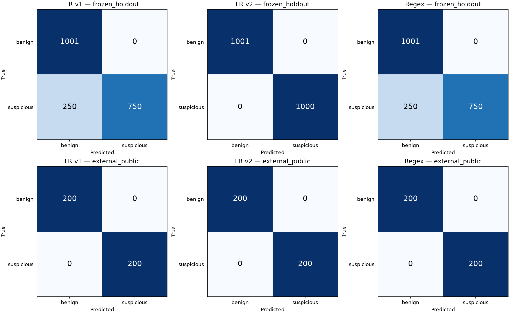
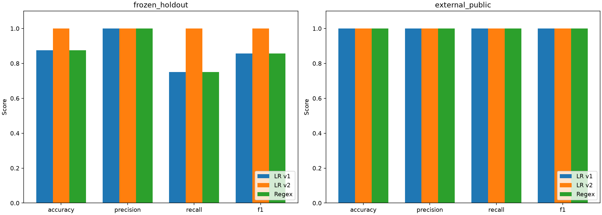
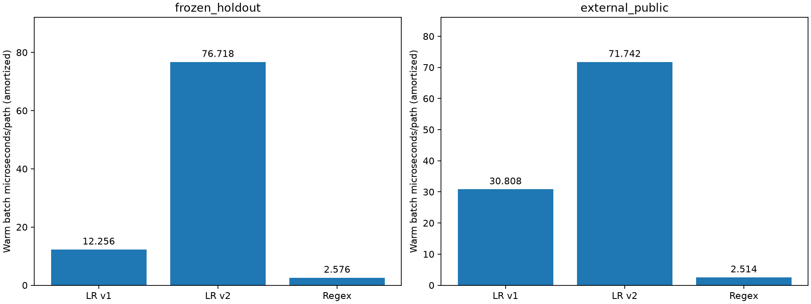

# Thực nghiệm LR v1 / LR v2 / Regex

UTC: 2026-11-16T15:49:01.695517+00:00. Reference test cố định: 20261116T153450Z_e5b13b.

## Quy trình và giới hạn độc lập

Reference test outcomes were disclosed before feature design; this is a reused benchmark, not a pristine blind test.
Không dùng nhãn test để chọn cấu hình. Bộ đặc trưng v2 cố định trước lựa chọn C. Chỉ validation từ original train được dùng chọn C; sau đó refit trên toàn bộ original train. Giai đoạn evaluate không có lệnh fit. Tập ngoài thu thập sau khi đóng băng model, không dùng để sửa đặc trưng hoặc chọn C. Không thay model đang triển khai.
Fit/validation: 6583/1416; refit 7999. C được chọn: 0.1; ngưỡng 0,5 cố định.
Candidate C = 0,1; 1; 10. Quy tắc chọn: validation F1 cao nhất, hòa chọn C nhỏ nhất.

| C | Validation Accuracy | Precision | Recall | F1 |
|---|---:|---:|---:|---:|
| 0.1 | 1.000000 | 1.000000 | 1.000000 | 1.000000 |
| 1.0 | 1.000000 | 1.000000 | 1.000000 | 1.000000 |
| 10.0 | 1.000000 | 1.000000 | 1.000000 | 1.000000 |

## frozen_holdout

N=2001; nhãn: {'0': 1001, '1': 1000}.

| Method | Accuracy | Precision | Recall | F1 | TN | FP | FN | TP |
|---|---:|---:|---:|---:|---:|---:|---:|---:|
| LR v1 | 0.875062 | 1.000000 | 0.750000 | 0.857143 | 1001 | 0 | 250 | 750 |
| LR v2 | 1.000000 | 1.000000 | 1.000000 | 1.000000 | 1001 | 0 | 0 | 1000 |
| Regex | 0.875062 | 1.000000 | 0.750000 | 0.857143 | 1001 | 0 | 250 | 750 |

| Timing | Median batch ms | P95 batch ms | Amortized µs/path |
|---|---:|---:|---:|
| lr_inference_only | 0.293700 | 0.434260 | 0.146777 |
| lr_end_to_end | 24.525100 | 26.659500 | 12.256422 |
| improved_inference_only | 0.397600 | 0.584890 | 0.198701 |
| improved_end_to_end | 153.513400 | 164.017080 | 76.718341 |
| regex_end_to_end | 5.155200 | 6.714770 | 2.576312 |

## external_public

N=400; nhãn: {'0': 200, '1': 200}.

| Method | Accuracy | Precision | Recall | F1 | TN | FP | FN | TP |
|---|---:|---:|---:|---:|---:|---:|---:|---:|
| LR v1 | 1.000000 | 1.000000 | 1.000000 | 1.000000 | 200 | 0 | 0 | 200 |
| LR v2 | 1.000000 | 1.000000 | 1.000000 | 1.000000 | 200 | 0 | 0 | 200 |
| Regex | 1.000000 | 1.000000 | 1.000000 | 1.000000 | 200 | 0 | 0 | 200 |

| Timing | Median batch ms | P95 batch ms | Amortized µs/path |
|---|---:|---:|---:|
| lr_inference_only | 0.709800 | 0.811550 | 1.774500 |
| lr_end_to_end | 12.323000 | 14.075090 | 30.807500 |
| improved_inference_only | 0.792200 | 1.343950 | 1.980500 |
| improved_end_to_end | 28.696900 | 31.886580 | 71.742250 |
| regex_end_to_end | 1.005800 | 1.445460 | 2.514500 |

## Phân tích FN và đặc trưng

V1 chỉ nhìn một lớp unquote khi đếm traversal; các cờ encoded_dot/slash/backslash chỉ tìm escape một lớp trong chuỗi gốc. `%252e%252e%252f` chưa xuất hiện dưới dạng `../` trong các tín hiệu này. Regex v1 cũng chỉ kiểm tra marker một lớp. V2 giữ 18 đặc trưng v1 và thêm 12 tín hiệu cấu trúc tổng hợp trên raw/decode1/decode2: parent component, tỷ lệ parent, absolute/drive/UNC, separator, mixed separator, escape depth, dot component, null, structural escape và số lượt decode làm thay đổi chuỗi. Các tín hiệu dùng chung giữa mức mã hóa giúp học từ raw/single encoding trong train; không biến quy tắc thành nhãn hay quyết định truy cập.
Giải mã tối đa đúng hai lần, chỉ trong ML; không unquote_plus, không chuyển kết quả này tới open_authorized. security.py và extract_features v1 giữ nguyên hành vi.

## Tập ngoài và gắn nhãn

Chi tiết nguồn, commit, snapshot hash, lọc, duplicate và provenance từng dòng: external_manifest.json, external_cases.csv và README.md trong data/external/<snapshot>. Nhãn được gắn bằng chính sách lexical, không dùng dự đoán LR/regex. Đây là corpus công khai có chọn lọc, không phải traffic thực tế hoặc bộ chuẩn do bên thứ ba gán nhãn. Benign là tên file tương đối trong repo Flask, không phải benign HTTP traffic. Tương quan nguồn với nhãn và nhiều biến thể cùng payload làm giới hạn khả năng tổng quát hóa. Nhãn suspicious không khẳng định khai thác thành công trên FileGuardAI.

## Diễn giải

Chỉ kết luận theo từng tập và từng chỉ số, không tự khẳng định v2 tốt hơn. Nếu recall tăng nhưng false positives tăng phải báo cả hai. Tập test cũ từng được công bố nên chỉ là reused benchmark; cần test tương lai được bên độc lập thu thập và khóa trước khi tiếp tục nghiên cứu. Thời gian là warm batch chia số mẫu, không phải độ trễ HTTP; raw timings lưu JSON. Không có dữ liệu mới được đưa vào model triển khai.

## Bằng chứng

- protocol.json + selection.json: kế hoạch, validation, model freeze.
- development_split.csv: fit/validation từ original train.
- holdout_predictions.csv / external_predictions.csv: từng nhãn, xác suất, dự đoán.
- baseline_model.joblib / improved_model.joblib: model so sánh lưu riêng.
- results.json / manifest.json: chỉ số, timings, hash.
