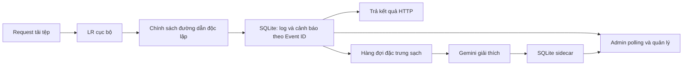

# Phát hiện, cảnh báo và giải thích tự động

## Pipeline vận hành

Mỗi GET `/download` tiếp tục chạy Logistic Regression và kiểm tra đường dẫn
độc lập. Chính sách quyết định ALLOW/BLOCK/MISS và HTTP 200/403/404. Trong
giao dịch ghi access_logs, hệ thống đồng thời tạo hoặc gom cảnh báo và lưu
liên kết Event ID. Sau commit mới đưa đặc trưng vào hàng đợi Gemini hiện có.
Không gọi mạng hoặc chờ Gemini để tạo cảnh báo. Không dùng mức rủi ro AI để
cấp quyền tải tệp. Nếu không ghi được giao dịch nhật ký thì vẫn áp dụng
hành vi 503 sẵn có, không trả tệp khi không lưu được bằng chứng.

| Điều kiện cục bộ | Rule | Ưu tiên xử lý | Ý nghĩa |
|---|---|---|---|
| action=BLOCK, bất kể LR | policy_block | Cao | Chính sách đã từ chối; chưa chứng minh khai thác thành công |
| Không BLOCK và ml_label=suspicious | ml_suspicious | Trung bình | Cảnh báo ML, có thể false positive; không sửa ALLOW/MISS |
| Không BLOCK, không suspicious | Không cảnh báo | — | Nhật ký vẫn được lưu, kể cả MISS hoặc ML không khả dụng |

Ưu tiên trên là quy tắc vận hành đã định nghĩa, không phải xác suất ML hay
phân loại rủi ro tham khảo của Gemini. Một yêu cầu bị BLOCK có thể do chính
sách đầu vào/quyền truy cập, không được diễn giải mọi BLOCK là tấn công đã
xác nhận. LR false negative không ngăn việc tạo cảnh báo khi policy BLOCK;
LR false positive trên tệp hợp lệ vẫn cho tải và chỉ tạo cảnh báo trung bình.

## SQLite và chống trùng

Thêm ba bảng bằng `CREATE TABLE IF NOT EXISTS` tại init_db:

- alerts: rule, priority, state, first_event_id, last_event_id, occurrences,
  created/updated (Unix UTC), fingerprint.
- alert_events: mỗi Event ID liên kết đúng một nhóm cảnh báo.
- alert_settings: trạng thái thông báo trực tiếp dành cho Admin.

Log và liên kết cảnh báo cùng giao dịch SQLite; không có lời gọi API trong
giao dịch. Gom nhóm cùng IP + rule + bộ đặc trưng cấu trúc đã làm sạch,
trong 60 giây tính từ lần tạo nhóm. Đây là gom tương đồng, không khẳng định
hai chuỗi đường dẫn giống hệt. Giữ riêng từng access_logs và alert_events;
không xóa hoặc bỏ sự kiện vì rate limit. Nhóm đã xử lý không nhận gộp sự
kiện mới; nhóm mới được tạo. Nhóm đã xem giữ trạng thái đã xem khi tăng bộ
đếm trong cửa sổ. Hết 60 giây tạo nhóm mới.

Không backfill cảnh báo cho nhật ký lịch sử; bắt đầu từ request sau nâng cấp.
Không chạy ứng dụng production trong đợt kiểm thử này; các bảng mới trên DB
nghiệp vụ sẽ được tạo khi người vận hành khởi động bản đã review.

Gemini tiếp tục dùng SQLite sidecar, liên kết access_logs bằng Event ID;
provider/model được lưu ở provenance. Backup hai file SQLite theo cùng mốc
vận hành để giữ liên kết. Không sửa dữ liệu phân tích cũ.

## Giao diện, quyền và thông báo

Admin mở sidebar **Security Alerts** hoặc `/dashboard/alerts`:

- Lọc trạng thái Mới / Đã xem / Đã xử lý và ưu tiên Cao / Trung bình.
- Phân trang máy chủ 50 nhóm/trang, liên kết sự kiện đầu/gần nhất.
- Cập nhật trạng thái bằng POST có CSRF; ghi security_events cùng giao dịch.
- Bật/tắt thông báo trực tiếp bằng POST có CSRF và audit.
- Event Detail hiển thị nhóm cảnh báo cục bộ và giải thích Gemini độc lập.

Guest không được xem dữ liệu quản trị; Auditor không được truy cập cảnh báo,
feed hoặc cấu hình Admin. Feed không trả IP hoặc đường dẫn.

Dashboard và trang quản lý polling `/dashboard/alerts/feed` mỗi 5 giây khi
tab hiển thị. Request có timeout 4 giây; lỗi mạng/auth/JSON dẫn tới thông báo
lỗi nhẹ và backoff tối đa 60 giây. Không có request polling chồng nhau. Lần
đầu lấy mốc hiện tại để không phát lại mọi cảnh báo lịch sử. Feed trả tối đa
20 nhóm/lượt và cursor theo nhóm đã đọc, không bỏ qua backlog quá 20 nhóm.

Tối đa 3 thông báo hiển thị/phút/trang, chỉ giữ 3 liên kết gần nhất trong
vùng thông báo. Những nhóm vượt giới hạn vẫn được lưu và đếm trong trang
quản lý; không đảm bảo mọi nhóm đều có thông báo riêng. Khi tắt thông báo,
feed vẫn trả số nhóm mới nhưng không phát item; các cảnh báo phát sinh khi
tắt không được phát lại sau đó. Lựa chọn tắt có hiệu lực ở lần polling kế
tiếp; cảnh báo và nhật ký vẫn tiếp tục lưu. Rate limit này ở UI, không phải
biện pháp chống DoS cho endpoint; cần rate limit reverse proxy khi triển khai.

Không thêm Telegram/email trong đợt này để tránh gửi dữ liệu ra kênh ngoài
khi chưa có cấu hình và chính sách người nhận. Không có browser push ngoài
trang Admin; đóng trang thì không có thông báo. Mỗi tab có ngân sách UI riêng.

## Gemini và dữ liệu nhạy cảm

Xem [hướng dẫn Gemini](GEMINI_INTEGRATION.md). Chỉ gửi decision, ml_alert và
cờ/số đếm cấu trúc; không gửi Event ID, IP, đường dẫn, tên tệp, nội dung tệp,
mật khẩu hoặc token người dùng. Key dịch vụ chỉ ở biến môi trường phía máy
chủ. Không có key/model thì offline, cảnh báo cục bộ vẫn hoạt động.

Hàng đợi 16 tác vụ mặc định, timeout Gemini mặc định 20 giây/tối đa 60 giây
(adapter OpenAI-compatible chung tối đa 10 giây), giới hạn API dùng chung
20 lượt/giờ mặc định, cache thành công 24 giờ, cache lỗi 60 giây. Quota,
authentication, timeout, network, invalid_response không sửa quyết định
bảo vệ hoặc xóa cảnh báo. Chỉ Admin bật/tắt giải thích tại Dashboard.

## Huấn luyện và đánh giá tái lập

Tái sử dụng `python tools/evaluate_strict_groups.py`; không tạo pipeline thứ
hai hoặc tự thay model triển khai. Dữ liệu có cột path,label,family; label
0/1. `ml/strict_groups.py` gộp các family có chuỗi canonical tương đương
trước khi tách train/validation/test. Từ chối nhãn mâu thuẫn hoặc thiếu nhóm;
kiểm tra family/path/canonical overlap giữa cả ba tập.

C chỉ chọn trong train/validation; lưu plan trước fit và khóa model trước
khi đánh giá test. Refit trên train+validation sau khi chọn C, tuyệt đối
không fit trên test. Mỗi lần tạo thư mục mới trong docs/evaluations gồm
split.csv, model thử nghiệm, dự đoán, metrics, confusion matrix và biểu đồ.
Không ghi đè artifacts/model.joblib hoặc model thực nghiệm cũ. Không tự
triển khai model mới. AI Evaluation/Training hiện có giữ lịch sử run.

LR v1/v2 trong bảng bên dưới là các model huấn luyện ở run mới, với hai
phiên bản trích xuất đặc trưng; không đồng nghĩa model đang phục vụ request.

Run thực tế đợt này: `docs/evaluations/20261118T094256Z_8c5825`.
Train 6500, validation 1999, test 1501; refit 8499. Family/path/canonical
overlap đều rỗng; 26 thành phần nhóm sau gộp canonical, seed 2026.

| Tập | Phương pháp | Accuracy | Precision | Recall | F1 | Confusion matrix [TN,FP;FN,TP] |
|---|---|---|---|---|---|---|
| Test 1501 | LR v1 | 1.0 | 1.0 | 1.0 | 1.0 | [[1001,0],[0,500]] |
| Test 1501 | LR v2 | 1.0 | 1.0 | 1.0 | 1.0 | [[1001,0],[0,500]] |
| Test 1501 | Regex | 1.0 | 1.0 | 1.0 | 1.0 | [[1001,0],[0,500]] |
| Corpus ngoài 236 | LR v1 / LR v2 / Regex (từng phương pháp) | 1.0 | 1.0 | 1.0 | 1.0 | [[118,0],[0,118]] |

Số liệu lấy từ results.json của run trên, không phải hiệu quả ngăn chặn
thực tế. Dữ liệu tổng hợp đã được nghiên cứu trước đó và corpus ngoài có
nhãn lexical; đây không phải blind test thế giới thực. **Kết quả 100% không
chứng minh phát hiện hoặc ngăn chặn 100% tấn công thực tế.** Không dùng kết
quả này để tự chọn lại đặc trưng/siêu tham số trên test.

Log kiểm thử và báo cáo đợt nâng cấp: `docs/h07/evidence/alerts_20261118/`.
Không hardcode key, không push/merge hay triển khai production.
