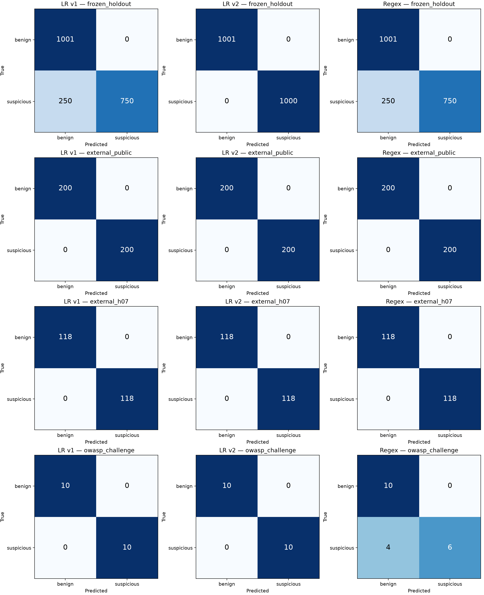
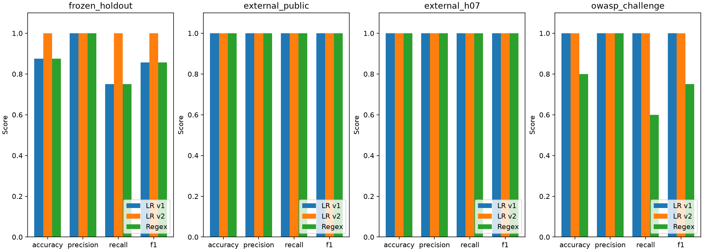
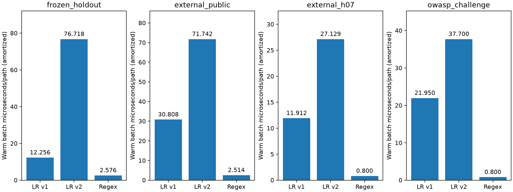

# Chương 4 — Kết quả thực nghiệm và nghiệm thu

Lượt hoàn thiện H07: **17/11/2026 (Asia/Saigon)**. Pipeline v1/v2 đã
đóng băng từ lượt trước, không fit hoặc chỉnh threshold theo corpus mới.
Dataset/metrics dự đoán và source hashes được lưu để tính lại. Một lỗi
đọc UTF-8 bằng cp1252 trong test/tool Windows được phát hiện và sửa;
đầu ra lượt lỗi được giữ, không tính thành PASS.

## 1. Kiểm thử chức năng/bảo mật

| Bộ kiểm thử | Kết quả thực tế | Bằng chứng |
|---|---|---|
| Toàn bộ pytest cuối sau sửa encoding | 76 PASS, 3 SKIP, 15 subtests PASS | [pytest_verified.txt](evidence/final_20261117/pytest_verified.txt), [XML](evidence/final_20261117/pytest_verified.xml) |
| TCP dashboard + CSRF + RBAC/export | 27 PASS, 0 FAIL | [JSON](../evaluations/dashboard_http_20261116T172733Z_800c38_http_f0a06e843e16.json) |
| TCP download chi tiết | 33 PASS, 3 SKIP, 0 FAIL | [TC và bằng chứng](../evidence/tcp_20261116T173538Z_31e4cd/test_cases.md) |
| Smoke download | 10/10 PASS | [smoke](../evidence/tcp_20261116T173538Z_31e4cd/smoke_http.txt) |
| Kiểm tra quyền/CSRF/hash/log | 7 test auth PASS trong suite | tests/test_auth.py |
| Tạo symlink thật | 3 SKIP, WinError 1314 | [summary](evidence/final_20261117/symlink_summary.json) |

Bản clone sạch của commit 537c286, không có CSV/model triển khai bị
gitignore ban đầu, đã chạy prepare_workspace và đạt **76 PASS, 3 SKIP**:
[cold_clone.txt](evidence/final_20261117/cold_clone.txt),
[XML](evidence/final_20261117/cold_clone.xml). Không cài lại dependencies
trong phép kiểm tra clone này; dùng cùng venv đã xác minh.
Backup CLI thật của fixture tạo được 144 dòng, integrity=ok, source không
đổi: [backup_verification.json](evidence/final_20261117/backup_verification.json).
File DB backup giữ local, không đưa vào Git.

Đã thử lại symlink ngoài sandbox: harness độc lập vẫn 3 SKIP/1314.
Các lần pytest ngoài sandbox ban đầu còn lỗi setup do quyền/cấu trúc
thư mục Temp; không tính là PASS hoặc lỗi authorization của ứng dụng.
Không tự bật Developer Mode/SeCreateSymbolicLinkPrivilege. Junction
Windows tạo được, các ca escape và không duyệt target đã PASS.

Các trường hợp 200/403/404, Unicode/dấu cách/subdir, ../, ..\, absolute,
encoded/double/multi encoding, NUL/ADS/device, duplicate path và input dài
có test. AI chấm sai hoặc lỗi không cấp quyền. Không ca đã thực hiện
nào trả nội dung marker ngoài kho. Không thay schema bằng cách xóa log;
chỉ tạo bảng/index/trigger mới trong init nếu còn thiếu.

## 2. Hiệu năng và tỷ lệ ngăn chặn HTTP

Lượt đo cuối riêng: [performance.json](evidence/20261116T173449Z_846a59/performance.json).
3 lượt ×48 request, 4 worker; 144 request/144 log, SQLite integrity=ok,
0 sai HTTP hoặc body, 0 leak. Mỗi lượt có 30 policy violation; còn lại
file hợp lệ/thiếu. Đây là kiểm tra localhost trên fixture do chủ quản lý,
không benchmark production hoặc chứng minh block mọi payload.

| Lượt | RPS | P50 ms | P95 ms | P99 ms | Block / policy violation |
|---|---:|---:|---:|---:|---:|
| 1 | 46,46 | 65,6095 | 166,9528 | 329,2867 | 30/30 |
| 2 | 47,26 | 72,4569 | 163,3494 | 188,9055 | 30/30 |
| 3 | 46,76 | 72,8793 | 165,4213 | 253,7281 | 30/30 |

Tổng **90/90 violation bị chặn =100% trên tập này**, không có nội dung
ngoài kho. Đọc hết body để đo latency, gồm Flask/model/SQLite/TCP.
Đây là 5 kiểu vi phạm lặp lại, không phải 90 payload độc lập.
404 không được cộng vào tấn công; rate này không phải Recall ML.
Lượt sơ bộ chạy đồng thời với tests có số đo khác, được giữ tại
evidence/20261116T171755Z_810eaa; không chọn số đẹp nhất để báo cáo.

## 3. LR v1, v2 và regex trên test khóa cũ

Giữ nguyên 2.001 dòng, LR v1/v2 không thay hệ số. V1 và regex:
Accuracy=0,875062; Precision=1; Recall=0,75; F1=0,857143;
CM=[[1001,0],[250,750]]. V2: các chỉ số=1, CM=[[1001,0],[0,1000]].

Test này **đã công bố** và có 15 đường dẫn tương đương canonical giữa
train/test, nên không gọi là blind/hoàn toàn độc lập. Phân tích bổ sung
1.986 dòng đã loại overlap có trong [báo cáo rà soát](../BAO_CAO_TONG_HOP.md).
Không sửa test hoặc tuning để cải thiện số đo lần này. Các số liệu
holdout và corpus cũ trong artifact/dashboard mới là **kế thừa snapshot
cũ**, không phải đo tốc độ lại trong lượt fetch mới.

## 4. Corpus nguồn ngoài mới — LFISuite + Starlette

- **236 mẫu**, 118 mỗi nhãn, không canonical overlap với 10.000 mẫu gốc
  hoặc external 400 cũ; không duplicate canonical nội bộ.
- Positive: SecLists LFI-LFISuite-pathtotest tại commit
  `4d5e414c9631f3c12ee1ac86ff7234d848391fd3`.
- Negative: tên file tương đối repo Starlette 0.48.0, commit
  `e18637c68e36d112b1983bc0c8b663681e6a4c50`.
- Policy chọn mẫu và hash model ghi **trước fetch**; không dùng model
  prediction chọn mẫu. Labels là cú pháp, không khai thác thành công.
- Snapshot, license, URL/revision/line và lý do nhãn mỗi dòng được giữ:
  [cases.csv](../../data/external/h07_20261116T171550Z_5b8ba9/cases.csv),
  [manifest](../../data/external/h07_20261116T171550Z_5b8ba9/manifest.json).

| Method | Accuracy | Precision | Recall | F1 | Confusion matrix |
|---|---:|---:|---:|---:|---|
| LR v1 | 1 | 1 | 1 | 1 | [[118,0],[0,118]] |
| LR v2 | 1 | 1 | 1 | 1 | [[118,0],[0,118]] |
| Regex | 1 | 1 | 1 | 1 | [[118,0],[0,118]] |

Corpus chỉ có raw syntax, chưa kiểm chứng encoding khó. Không tự tạo
biến thể rồi gọi là nguồn công khai độc lập. Cả ba bằng nhau, chưa chứng
minh v2 hơn baseline trên corpus này.

## 5. Public OWASP encoding challenge riêng

10 attack-intent examples trích nguyên dạng từ
[OWASP Path Traversal](https://community.owasp.org/attacks/Path_Traversal),
được kiểm tra thực có trong page và lưu page hash; 10 đối chứng Starlette
chọn bằng SHA trước prediction. Có 6 single-encoding, 2 double-encoding,
2 legacy overlong. Không overlap canonical với 10.000 mẫu gốc, nhưng
các ví dụ tương quan nhau và chia sẻ control với corpus mới; **không
cộng gộp để giả định các mẫu độc lập**.

| Method | Accuracy | Precision | Recall | F1 | Confusion matrix |
|---|---:|---:|---:|---:|---|
| LR v1 | 1 | 1 | 1 | 1 | [[10,0],[0,10]] |
| LR v2 | 1 | 1 | 1 | 1 | [[10,0],[0,10]] |
| Regex | 0,8 | 1 | 0,6 | 0,75 | [[10,0],[4,6]] |

V1/v2 hơn regex trên challenge nhỏ này, **v2 chưa hơn v1**. Legacy
overlong là ý định tấn công được nguồn mô tả, không phải UTF-8 traversal
hợp lệ trên Flask hiện đại. Không suy từ label=1 sang HTTP phải 403.
[Nguồn/nhãn](../../data/external/owasp_20261116T172733Z_800c38/cases.csv),
[dự đoán từng dòng](../evaluations/20261116T172733Z_800c38/owasp_predictions.csv).

## 6. Chỉ số thời gian ML và biểu đồ

15 lượt warm batch mỗi corpus mới; end-to-end gồm features+predict,
inference-only báo riêng. Tất cả thời gian thô, median/P95 batch và
amortized µs/path nằm trong
[results.json](../evaluations/20261116T172733Z_800c38/results.json),
các key datasets.external_h07 và datasets.owasp_challenge.timing.
Không gọi số chia từ batch là latency của một HTTP request.

| Corpus mới | LR v1 µs/path | LR v2 µs/path | Regex µs/path |
|---|---:|---:|---:|
| LFISuite + Starlette, 236 mẫu | 11,911864 | 27,128814 | 0,799576 |
| OWASP challenge, 20 mẫu | 21,950000 | 37,700000 | 0,800000 |

Các giá trị là median warm batch chia số dòng, cùng điều kiện của từng
corpus; không có bằng chứng v2 nhanh hơn baseline.

## 7. Kết luận giới hạn và việc còn thiếu

Source/label confounding, lexical weak annotation, benchmark đã xem,
nhóm biến thể tương quan và không có traffic thực vẫn là hạn chế. Không
thể tuyên bố v2 production-ready hay tổng quát hóa 100%. Symlink thật
chưa chạy được ở máy này, Windows TOCTOU vẫn cần ACL hoặc Win32 handle
authorization trước khi bỏ giả định kho tin cậy.

[Ma trận 12 PI](../MA_TRAN_H07.md) là tự đánh giá minimum MVP, không thay
phê duyệt giảng viên. Phần chưa đủ minh chứng phải giữ trạng thái Chưa đạt.
CI chỉ được thêm cấu hình; trạng thái remote cần xem trên PR sau khi chạy.
