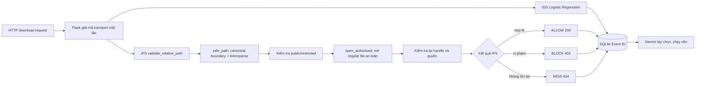

# Báo cáo Application-layer IPS — PI 3.1

Ngày xác minh: **19/11/2026**. Đề tài: **Xây dựng hệ thống phát hiện và ngăn chặn tấn công Path Traversal trên ứng dụng web sử dụng thuật toán Logistic Regression**.

## 1. Phạm vi và phân định IDS/IPS

- **IDS:** Logistic Regression trích xuất đặc trưng chuỗi đường dẫn, trả xác suất và nhãn `benign/suspicious`. IDS cung cấp tín hiệu nghiên cứu và cảnh báo; lỗi tải model hoặc lỗi dự đoán không vô hiệu hóa IPS.
- **IPS:** `app/security.py`, `app/documents.py` và luồng `/download` kiểm tra cú pháp, canonical path, liên kết hệ thống tệp, loại tệp và quyền tải. IPS độc lập với điểm LR và Gemini, là thành phần duy nhất xác lập `ALLOW/BLOCK/MISS`.
- **Gemini:** xử lý bổ sung sau khi quyết định và Event ID đã được ghi. Gemini không tham gia cấp quyền.



## 2. Nguyên lý chuẩn hóa và chính sách

1. Flask thực hiện giải mã URL ở tầng transport đúng một lần. Mã không gọi `unquote` lặp. Escape cấu trúc còn sót `%25`, `%2e`, `%2f`, `%5c`, `%00`, `%3a` bị từ chối, vì vậy double encoding không được “bóc” không giới hạn.
2. Chỉ chấp nhận đường dẫn tương đối phân cách bằng `/`. Từ chối chuỗi rỗng/quá dài, thành phần `.`/`..`, dấu `\`, `/` đầu chuỗi, drive Windows, ký tự điều khiển, tên thiết bị Windows và ký tự tên tệp nguy hiểm.
3. `safe_path` duyệt từng thành phần bằng `lstat`, từ chối symlink/reparse point, resolve canonical và bắt buộc kết quả thuộc `shared_files`.
4. POSIX mở từng thư mục bằng directory FD và `O_NOFOLLOW`; Windows lấy final path từ handle kernel sau khi mở. Chỉ regular file được tải.
5. Thư mục `restricted/` yêu cầu phiên User/Auditor/Admin hợp lệ. Quyền được kiểm tra trước và sau khi mở handle. Vi phạm phạm vi luôn được xử lý trước quyền đăng nhập.
6. Không ghi được nhật ký thì fail closed: không trả nội dung tệp.
7. Không có endpoint hoặc tùy chọn Admin để tắt IPS.

## 3. Trạng thái và dữ liệu trang Admin

Trang `/admin/ips` chỉ cho Admin đã hoàn tất TOTP. Trang đọc trực tiếp từ `access_logs`, `download_context` và `processing_timings` trong SQLite, gồm tổng yêu cầu, ALLOW, IPS BLOCK, MISS, nguyên nhân, biểu đồ theo phút, Event ID, điểm/nhãn IDS và thời gian IDS/IPS/tổng. Từ chối tải tài liệu hạn chế do chưa đăng nhập được tách khỏi vi phạm Path Traversal.

`processing_timings` là bảng cộng thêm, liên kết 1–1 bằng Event ID và có trigger cấm UPDATE/DELETE. `duration_ms/total_ms` đo đến lúc xác lập phản hồi trước ghi log và trước truyền hết body; đây không phải thời gian tải hoàn chỉnh ở client.

## 4. Kết quả thực tế

### Pytest

| Kết quả | Số lượng |
|---|---:|
| PASS | 397 |
| FAIL | 0 |
| ERROR | 0 |
| SKIP | 3 |
| Subtests PASS | 15 |

Thời gian: 435,25 giây. Log: [`evidence/ips_pi31_20261119T154012Z/pytest.txt`](evidence/ips_pi31_20261119T154012Z/pytest.txt).

Ba SKIP là ca tạo symlink trên Windows do tiến trình không có quyền symlink/Developer Mode. Không có môi trường Linux trong lượt xác minh này, vì vậy **không đánh dấu PASS cho symlink Linux**. Các kiểm tra giả lập handle Windows và unit test chính sách vẫn PASS nhưng không thay thế bằng chứng symlink Linux thật.

### HTTP TCP localhost với mô hình thật

| Ca | Kỳ vọng | Thực tế | Kết quả |
|---|---:|---:|---|
| `ok.txt` | 200 | 200 | PASS |
| tệp không tồn tại | 404 | 404 | PASS |
| `../outside.txt` | 403 | 403 | PASS |
| `..\outside.txt` | 403 | 403 | PASS |
| `C:/Windows/win.ini` | 403 | 403 | PASS |
| URL encoding | 403 | 403 | PASS |
| double encoding | 403 | 403 | PASS |

Tổng: **7 PASS, 0 FAIL**; không phản hồi nào chứa sentinel ngoài `shared_files`. Dữ liệu máy đọc: [`report.json`](evidence/ips_pi31_20261119T154012Z/report.json).

Trong run 7 yêu cầu này: IDS trung bình **4,146 ms**, IPS trung bình **15,224 ms**, tổng trung bình **19,493 ms**, tổng lớn nhất **72,141 ms**. Số đo phụ thuộc máy, cache và kích thước mẫu; không phải cam kết production.

### Độc lập với IDS

- Test mock LR trả **0,01/benign** cho traversal vẫn nhận 403.
- Khi model không tồn tại, log ghi `ml_score=NULL`, `ml_label=unavailable`, traversal vẫn nhận 403.
- LR trả điểm cao cho tệp hợp lệ không tự làm IPS chặn tệp.
- Gemini lỗi/tắt không ảnh hưởng quyết định vì chỉ được submit sau khi Event ID đã lưu.

## 5. Giới hạn

- IPS tầng ứng dụng không chống được quản trị viên hệ điều hành độc hại. ACL của kho tệp phải ngăn người không tin cậy tạo junction/hardlink hoặc thay nội dung.
- Hardlink nằm sẵn trong kho không thể được nhận diện như symlink chỉ bằng canonical path; thư mục kho phải do tiến trình triển khai đáng tin cậy quản lý.
- Kết quả symlink/junction thật cần chạy thêm trên Linux và Windows có quyền phù hợp.
- Danh sách tệp được duyệt có giới hạn để chống cạn tài nguyên; đây không phải trình quản lý tệp tổng quát.
- Số liệu timing của run nhỏ chỉ phục vụ minh chứng Chương 4, không đủ cho kết luận tải lớn.

## 6. Lệnh tái lập

```powershell
..\.venv\Scripts\python.exe -m pytest -q -rs
..\.venv\Scripts\python.exe tools/verify_ips_http.py
```

Không có dataset, model, SQLite nghiệp vụ hoặc kết quả thực nghiệm cũ nào bị thay thế trong lượt hoàn thiện này.
