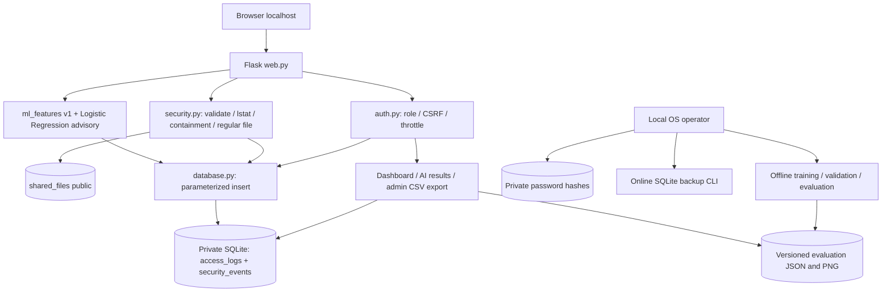
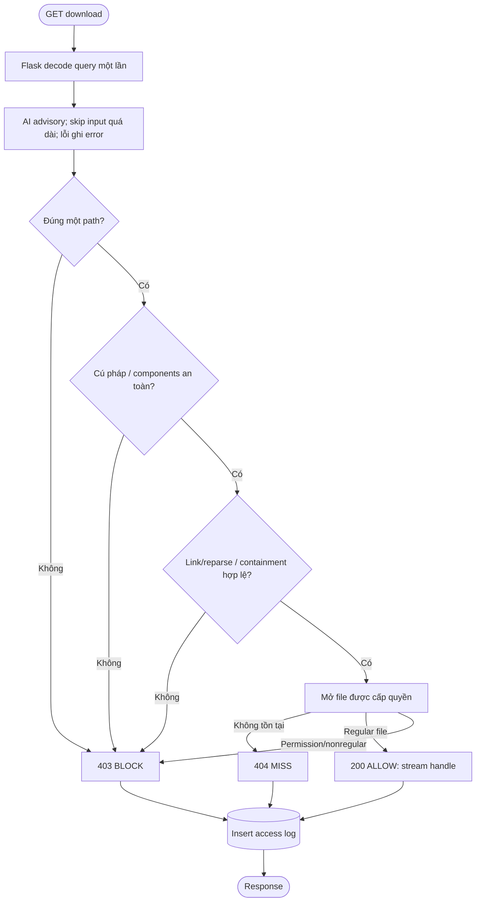
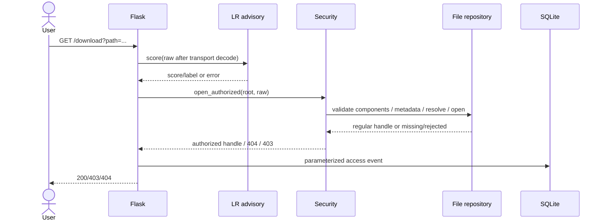
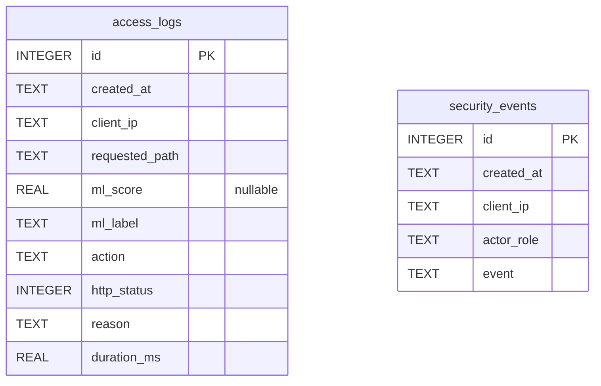

# Kiến trúc, Activity, Sequence và ERD

## Kiến trúc triển khai

Không có đường từ score AI sang cấp quyền filesystem. V2 nằm trong
artifact thực nghiệm; download vẫn dùng v1. FILES_ROOT không được chứa
DB, credential hoặc model; startup từ chối cấu hình vi phạm. Hai role
đăng nhập là admin và auditor, không có self-registration/upload/model
deployment API. Operator OS là tác nhân riêng, không đồng nhất cookie admin.

## Activity tải tệp

Nguồn UML Activity chuẩn PlantUML: [download_activity.puml](diagrams/download_activity.puml).

## Sequence

## ERD thực tế (không bịa bảng users)

Hai bảng độc lập, không có FK giả định. `actor_role` là nhãn sự kiện,
không FK users vì tài khoản admin/auditor cấu hình bằng hash file/env.
Access log: một dòng mỗi download; `ml_score` NULL khi unavailable/error/
skipped, action ALLOW/BLOCK/MISS tương ứng 200/403/404; `duration_ms` đo
xử lý trước truyền hết body, không phải latency end-to-end. Security
events không lưu mật khẩu, token hoặc cookie. Index: created_at cho
access_logs, (client_ip,created_at) cho security_events. Trigger cấm
UPDATE/DELETE cả hai bảng; INSERT được phép. Migration additive lúc
startup tạo bảng/index/trigger, không đổi hoặc xóa event cũ.

Session lưu role, trạng thái và CSRF trong cookie có chữ ký Flask;
không lưu password vào session. Hash password nằm ngoài kho public/Git.
