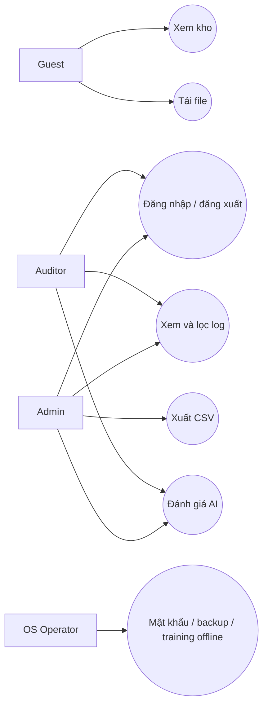

# Đặc tả Use Case H07

Actor: Guest, Auditor (đã xác thực, chỉ đọc), Admin (đã xác thực), Operator
(người quản trị OS, ngoài HTTP). Không có quyền tải ngoài shared_files ở
bất kỳ role web nào. Mọi POST web cần CSRF khi chạy bình thường.

| UC | Mục tiêu / Actor | Tiền điều kiện | Luồng chính | Ngoại lệ / hậu điều kiện |
|---|---|---|---|---|
| UC01 | Xem kho / Guest | Kho được cấu hình hợp lệ | GET / -> bounded listing -> các file qua cùng policy -> links | Không duyệt reparse; tối đa 200 file/10.000 entry; không thay file |
| UC02 | Tải tài liệu / Guest | Một query path | GET download -> advisory AI -> independent authorization -> stream -> append event | 403 policy, 404 thiếu file; Unicode/dấu cách/subdir được hỗ trợ; không dùng score cấp quyền |
| UC03 | Đăng nhập / Admin hoặc Auditor | Có hash role được operator cấu hình | GET login lấy CSRF -> POST role/password/token -> so hash -> clear session -> session role 15 phút | Token sai 403; credential sai thông báo chung; 5 lỗi/300s/IP thì 429 Retry-After; không ghi password/token |
| UC04 | Xem/lọc log / Admin, Auditor | Session role hợp lệ | GET dashboard?action=... -> validate ALLOW/BLOCK/MISS -> bound SQL -> 100 log gần nhất + summary + security events | Guest chuyển login, role khác 403, filter sai 400; chỉ đọc, không API sửa/xóa |
| UC05 | Xem đánh giá AI / Admin, Auditor | Artifact đánh giá có schema hợp lệ | GET AI evaluation -> đọc run pointer -> validate count/metrics -> bảng so sánh + PNG authenticated | Artifact lỗi hiển thị unavailable; ảnh chỉ ba tên cố định; không load model hoặc fit trong request |
| UC06 | Xuất log / Admin | Session admin, CSRF hợp lệ | POST export -> đọc tối đa 500 event -> CSV chống formula injection -> ghi logs_exported | Auditor 403, Guest redirect/login (hoặc CSRF 403 trước kiểm tra role); không trả file DB hoặc secret |
| UC07 | Đăng xuất / Admin, Auditor | Session + CSRF | POST logout -> append security event -> clear session -> redirect index | Thiếu CSRF 403; phiên mới không còn quyền dashboard |
| UC08 | Đặt/đổi mật khẩu / Operator | Quyền OS trên instance | CLI getpass -> 12–128 ký tự + confirm -> scrypt hash -> lưu file private -> sao lưu hash cũ -> restart | Không nhận password qua command line; không có UI đổi role hoặc đăng ký; restart làm hết hiệu lực session mặc định secret random |
| UC09 | Sao lưu / Operator | OS đọc DB, đích mới ngoài kho public | CLI SQLite online backup từ source read-only -> integrity_check -> giữ source | Không ghi đè backup; hash/DB không đưa lên Git; backup thật có thể chứa IP/path nên lưu private |
| UC10 | Nghiên cứu model / Operator | Dữ liệu và model reference đáng tin | train-family validation -> freeze -> test/evaluate -> JSON/predictions/plots | Không dùng test tune; giữ model triển khai; external corpus có nhãn lexical và giới hạn nguồn |

UC04 dùng `action`, ví dụ `/dashboard?action=BLOCK`. Export hiện xuất
500 dòng gần nhất toàn bộ quyết định, không tự áp dụng filter giao diện.

## Use Case Diagram

Sự kiện ghi log là phần của tải file; không phải chức năng tùy chọn để
người dùng vô hiệu hóa. Auditor không có quyền export hoặc thay tài khoản.
